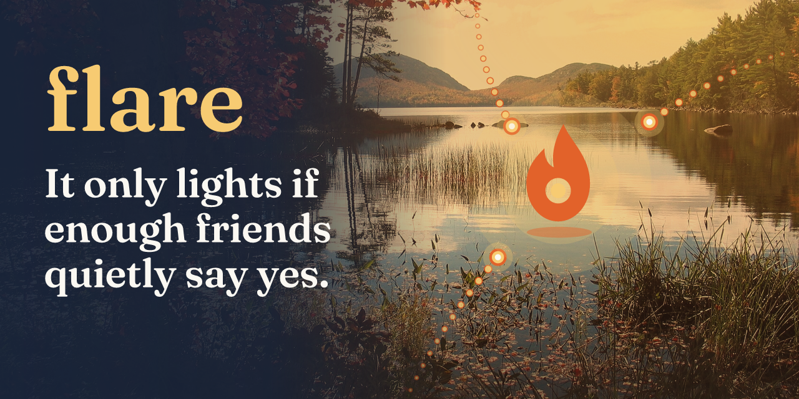
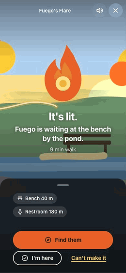
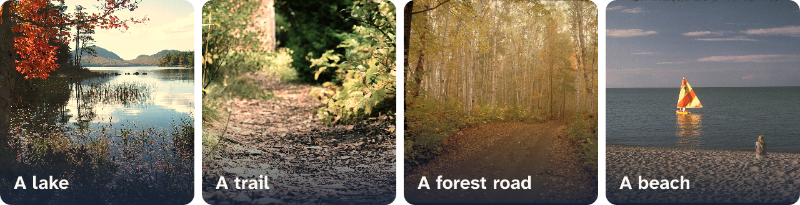
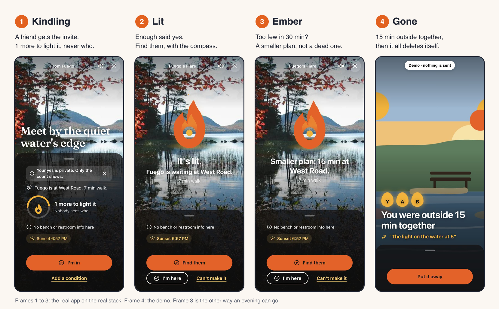
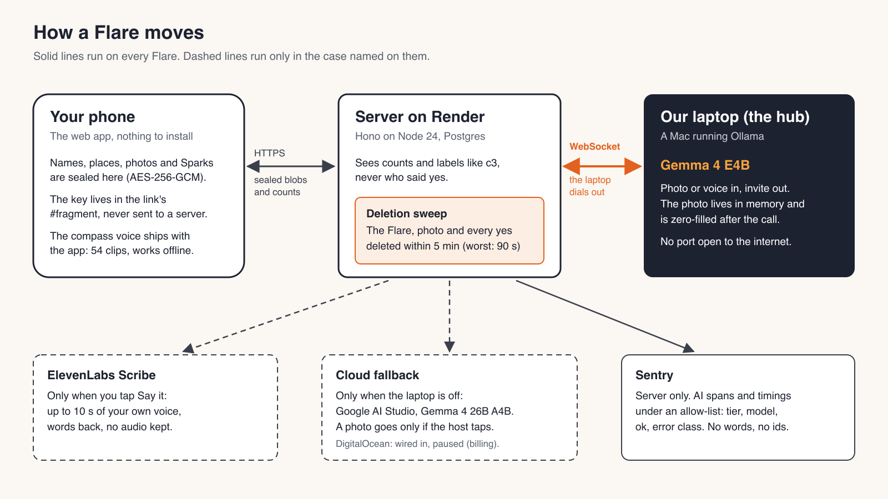

<p align="center">
  
</p>

<h1 align="center">Flare</h1>

<p align="center"><b>Snap where you are. If enough friends quietly say yes, it's on.</b></p>

<p align="center">
  <a href="https://flare-outside.onrender.com/app/demo/"></a>
  <a href="LICENSE"></a>
  <a href="package.json">=24.21.0" src="https://img.shields.io/badge/node-%3E%3D24.21.0-2E4A6B"></a>
  <a href="docs/handoffs/RESUME.md"></a>
  <a href="docs/website/lighthouse/summary.json"></a>
  <a href="docs/engineering/07-sunday-backlog.md"></a>
  <a href="docs/architecture/adr/0026-google-ai-studio-cloud-tier.md"></a>
  <a href="https://dev.to/challenges/hacktoberfest-week1-2026-10-05"></a>
  <a href="https://github.com/Hotragn/flare/actions/workflows/ci.yml"></a>
</p>

> **Built for the DEV Hacktoberfest Open-Source AI Challenge, Week 1 (Touch Grass).**
> **Started Oct 10, 2026:** the first commit is `27d4856` at 13:01 ET, inside the Oct 5 to 11 window.
> **Submission deadline:** Oct 11, 11:59 PM PDT (Oct 12, 06:59 UTC).
>
> **Changes after the deadline** (every commit after Oct 12, 06:59 UTC; nothing on the live site changed unless a line says so):
>
> - `ad59cc9`, Oct 12 07:09 UTC: privacy, docs and tests only. A real street name in code comments, one test and the field notes is now a neutral example ("Maple Road"). The OpenStreetMap pack in apps/web/static/maps is public map data and is unchanged.
> - `70689c3`, Oct 12 07:13 UTC: README only. README: challenge, start and deadline block at the top, with every post-deadline commit listed.
> - `987c12e`, Oct 12 07:16 UTC: docs only. Post v2 outline.
> - `94601f9`, Oct 12 07:20 UTC: README only. README: post-deadline commit hashes.
> - `ff17533`, Oct 12 07:25 UTC: docs, plus one static image: an unpublished longer draft of the post and a sprint timeline image at /post/sprints.png.
> - `9fea5f4`, Oct 12 07:25 UTC: README only. README: post-deadline list.
> - `ddf91e5`, Oct 12 07:32 UTC: docs, plus the sprint image relabelled. Post v2: the founder's How I used AI text, the method as sprints (Sprint 0 plans), timeline labels to match.
> - `57678f2`, Oct 12 07:37 UTC: docs only. Post v2: template headings, deletion timing, Entire causality, exact Sentry and ElevenLabs wording, new manager session embed.
> - `c09fabf`, Oct 12 07:39 UTC: docs only. Post v2: manager session embed xefvhu.
> - `20b7edd`, Oct 12 07:40 UTC: README only. README rewrite and cover v2 on Eagle Lake.
> - `89f1afe`, Oct 12 07:41 UTC: merge of the README and cover branch (README, brand images, one static image under /post/).
> - `37e029c`, Oct 12 07:44 UTC: README only. This list. The live site was redeployed after it to serve the new static images under /post/ (sprints.png, cover-v2.png); no app behaviour changed after the deadline: the commits since are comments, tests, docs and static images.
> - `415f319`, Oct 12 07:45 UTC: README and the longer post draft. The DEV post link and this wording.
> - `aba3b8d`, Oct 12 07:48 UTC: docs only. The longer post draft: Entire confirmed, the overall prize line, Sentry wording.
> - `8cb11ab`, Oct 12 07:52 UTC: docs only. The longer post draft: a voice pass, with facts, numbers and links unchanged.
> - `2b16791`, Oct 12 07:55 UTC: docs, plus one static image. A "What's inside" table in the longer post draft, and the live Crew space screenshot at /post/crew.jpg (the site was redeployed for it, static image only).
> - `09bb986`, Oct 12 07:59 UTC: README only. This list.
> - The next commit: README only. Exact times in this list.

<p align="center">
  <a href="https://flare-outside.onrender.com/app/demo/">60-second demo</a> ·
  <a href="https://flare-outside.onrender.com/app/">The app</a> ·
  <a href="https://dev.to/hotragn/flare-snap-where-you-are-and-it-only-lights-if-enough-friends-quietly-say-yes-1jc8">DEV post</a> ·
  <a href="#how-ai-was-used">Agent sessions</a> ·
  <a href="https://t.me/FairlaneFlareBot">Telegram bot</a>
</p>

<p align="center">
  
</p>

## Contents

- [Why Flare](#why-flare)
- [How it works](#how-it-works)
- [Features](#features)
- [Architecture](#architecture)
- [Tech stack](#tech-stack)
- [AI tiers and the enforce() guard](#ai-tiers-and-the-enforce-guard)
- [Privacy and deletion](#privacy-and-deletion)
- [Accessibility](#accessibility)
- [Quick start](#quick-start)
- [Configuration](#configuration)
- [Project structure](#project-structure)
- [Testing and quality gates](#testing-and-quality-gates)
- [Field tests and evaluation](#field-tests-and-evaluation)
- [Honest limits, then the roadmap](#honest-limits-then-the-roadmap)
- [Contributing](#contributing)
- [License and credits](#license-and-credits)
- [How AI was used](#how-ai-was-used)

## Why Flare

It's 4 PM on a Saturday. Someone in the group chat writes "we should go for a walk". Three people react with a thumbs up. Nobody goes.

The thumbs up is not the problem. Someone has to pick a time, a place and who's in, and someone has to be the first to say "OK, I'm going" and then wait to see if anyone else does. Under that sits a quieter fear: being the only one who wants to show up.

Flare is an installable web app for small groups of friends (2 to 12). A host sends a photo of where they are, or a Plan for later. Friends say yes in private, with conditions if they like ("after 2", "only with Amor"). It lights only when enough people can come, it shrinks to a smaller plan instead of failing, it works for friends with low vision or limited mobility and with no signal, and it deletes itself within 5 minutes of ending.

Tested on the real stack end to end, on two iPhones (16 Pro Max, 13) and in a 48-friend simulation; one short meetup in person so far ([field test 2](docs/research/field-test-2.md)).

<p align="center">
  
  <br><i>Places a Flare can happen. Photo credits are in <a href="#license-and-credits">License and credits</a>.</i>
</p>

## How it works



A Flare has four states. The rules are written down in [03-business-rules.md](docs/requirements/03-business-rules.md).

- **Kindling.** The Flare is out and waiting. Friends see "2 more to light it. Nobody sees who." The server stores labels like `c3`, not names, so a no is invisible and a yes is not exposed.
- **Lit.** It lights when the quorum is reached: 2, 3 or 4 people for a Flare, host included, 2 by default. Nobody walks out to meet zero people.
- **Ember.** If it isn't lit after 30 minutes, it shrinks to a smaller plan, quorum 2, at the nearest bench or picnic table within 400 m that fits everyone's needs.
- **Gone.** When the host taps We're done, or the Ember runs out, the Flare, its photo and every yes are deleted within 5 minutes (`GONE_GRACE_MS = 5 * 60_000` in [sweep.ts](apps/server/src/core/sweep.ts)).

## Features

| Feature | What it does | Status |
| --- | --- | --- |
| Photo Flare | A photo of where you are becomes a six-word invite, written by Gemma 4 | live |
| Private yes | Everyone sees the count, never who | live |
| Conditions | "after 2", "only with Amor", parsed on the phone ([rules.ts](apps/web/src/lib/conditions/rules.ts)) | live |
| Ember | Too few after 30 minutes, so it shrinks to a smaller plan nearby | live |
| Plans | A plan for later, with a ladder of smaller plans drafted by a Mastra agent ([ladder-agent.ts](apps/server/src/agent/ladder-agent.ts)) | live |
| Sparks | Short notes left on a Flare | live |
| Talking compass | Speaks the way to your friend in a recorded ElevenLabs voice, offline, and plays a tone when you face the right way | live |
| Access needs | Benches, restrooms and mapped steps within 200 m of the spot | live |
| Telegram card | Posts the six words to a group and deletes the card at Gone ([@FairlaneFlareBot](https://t.me/FairlaneFlareBot)) | live |
| Plain text | A 200-byte text form for SMS ([plaintext.ts](packages/shared/src/plaintext.ts)) | live, not yet tried over satellite |
| Demo and simulation | A 60-second demo, and a labelled 48-friend simulation at /sim/ | live |
| Remember this | A day card from a voice recording | off: failed on a real iPhone, the mic never started |
| Say it | A voice Spark | off: failed on a real iPhone, the mic never started |
| Sounds of the spot | Gemma names what you can hear nearby | measured, not shipped (8 of 12 voices at best) |
| Models in the browser | Gemma 4 E2B, SmolVLM and Qwen3-0.6B on the phone | measured, not shipped ([measured-not-shipped.md](docs/ai-runtime/measured-not-shipped.md)) |

## Architecture



- **The phone.** A web app, nothing to install. It seals names, places, photos and Sparks with AES-256-GCM and holds the group key in the link's `#fragment`, which browsers never send to a server. It runs the conditions parser and the compass offline.
- **The server on Render.** It stores sealed data, counts and labels, runs the state machine, sweeps ended Flares and serves the audit. It never sees a name or a place in plain text.
- **The hub on my laptop.** [apps/hub](apps/hub) dials out to the server over a WebSocket ([ADR-0006](docs/architecture/adr/0006-hub-outbound-relay.md)), takes one AI job at a time and hands it to Gemma 4 in Ollama. Photos stay in memory only.

### Who sees what

| Who | Sees | Never sees |
| --- | --- | --- |
| The phone | Everything for its own group, unsealed with the key in the link | Other groups |
| The server (Render) | Sealed blobs, counts, labels like `c3`, times | Names, places, the key |
| The hub (my laptop) | The photo or voice clip for one job, in memory | Who said yes |
| Google AI Studio | Plan inputs; a photo only after Ask cloud Gemma | Names, who said yes |
| ElevenLabs | 54 compass lines, once, at build time | Any user data |
| Telegram | The six words, the spot, the host's first name | Who said yes |
| Sentry | Span names, timings, model names | Our words or ids (a test fails if they reach it) |

## Tech stack

| Layer | Technology | Why |
| --- | --- | --- |
| Web app | SvelteKit, installable PWA | Nothing to install from a store; works offline |
| Server | Hono on Node, hosted on Render | Small HTTP API and the hub relay in one process ([ADR-0005](docs/architecture/adr/0005-hosting-render-https.md)) |
| Storage | Postgres (PGlite for local runs) | One store for sealed data and counts |
| Model, private tier | Gemma 4 E4B in Ollama on my laptop | Open, runs on a machine I own; the photo goes nowhere else |
| Model, cloud tier | Gemma 4 26B A4B on Google AI Studio | Same model family and guards when the laptop is off ([ADR-0026](docs/architecture/adr/0026-google-ai-studio-cloud-tier.md)) |
| Plan agent | Mastra, four local tools | Tools, a model call and tracing in TypeScript ([ADR-0025](docs/architecture/adr/0025-mastra-plan-agent.md)) |
| Conditions | Rules on the phone, taught with a Tinker LoRA | Under 1 ms, no model needed ([conditions-tinker.md](evals/reports/conditions-tinker.md)) |
| Compass voice | ElevenLabs, recorded once | Same voice on every phone, no signal needed ([ADR-0027](docs/architecture/adr/0027-elevenlabs-voice.md)) |
| Tracing | Sentry Agent Tracing | Timings per AI job, never our words ([ADR-0021](docs/architecture/adr/0021-sentry-agent-tracing.md)) |
| Group chat | Telegram Bot API | A card the bot can post and later delete ([ADR-0023](docs/architecture/adr/0023-telegram-card-and-photo-opt-in.md)) |
| Map data | OpenStreetMap pack | Places come from the map, never invented |

## AI tiers and the enforce() guard

Each AI job tries three tiers in order:

1. **The hub on my laptop:** Gemma 4 E4B (`gemma4:e4b-it-q4_K_M`) on Ollama. 39/40 photo scenes right, 3.0 s per photo on an idle Mac ([measured-not-shipped.md](docs/ai-runtime/measured-not-shipped.md)); a busy laptop measured a 4.0 s median ([photo-hub.md](evals/reports/photo-hub.md)).
2. **The cloud:** Gemma 4 26B A4B on Google AI Studio. Plan drafts use it automatically; a photo goes there only when the host taps **Ask cloud Gemma**.
3. **The template:** with no model at all, the host writes the six words and the rules engine does the rest.

The model picks the words. Code owns the facts. Every photo answer passes `enforce()` in [packages/shared/src/photo.ts](packages/shared/src/photo.ts) before it is shown or spoken: six words at most for the invite, twenty for the spoken line, and any answer that describes a face or a person is thrown out. Null means the host types the invite. The Plan ladder has its own guard, `enforceLadder()` in [ladder.ts](packages/shared/src/prompts/ladder.ts), which swaps any label that names a person or invents a place for a template label (13/13 valid in [ladder-agent-hub.md](evals/reports/ladder-agent-hub.md)).

## Privacy and deletion

The group key lives in the link's `#fragment`, which browsers never send to servers. Photos, names, places, coordinates and Sparks are sealed on the phone (AES-256-GCM) before upload. Conditions are parsed on the phone and only the rule is sent. To write the six words the photo goes to our laptop over an encrypted link and is held in memory only. Groups that choose Telegram trade some of this for convenience, and the app says so before they do.

You can check deletion yourself: [flare-outside.onrender.com/api/v1/audit](https://flare-outside.onrender.com/api/v1/audit) shows the live row counts and whether anything outlived its end. Full details: [security and privacy design](docs/architecture/08-security-privacy.md).

## Accessibility

- Every invite shows benches, restrooms and mapped steps within 200 m of the spot.
- The talking compass says the way out loud, so there is no map to read.
- The invite photo has a spoken description of 20 words or fewer for screen readers.
- Target: WCAG 2.2 AA on every screen, body text at 7:1 contrast or more, touch targets of 44 pt.
- Measured: axe 0 on 88 views (22 pages, 2 widths, 2 schemes) and 44 px targets ([07-sunday-backlog.md](docs/engineering/07-sunday-backlog.md)); Lighthouse 100 in all four categories on 5 site pages, mobile and desktop ([summary.json](docs/website/lighthouse/summary.json)).
- Known gap: a VoiceOver test on real iPhones is still to come ([accessibility statement](docs/content/05-accessibility-statement.md)).

## Quick start

**Using Flare needs nothing.** Open https://flare-outside.onrender.com/app/ (or the [demo](https://flare-outside.onrender.com/app/demo/)) and send the link to friends. The rest of this section is for hosting your own copy.

You need Node 24.21.0 or later ([.nvmrc](.nvmrc)). Pick one of three levels:

1. **No AI keys.** Everything works. The host writes the six words, with place-word chips from the map, and the rules engine does the rest. `npm run e2e:no-keys` checks this.
2. **A free Google AI Studio key.** Put `GEMINI_API_KEY=` in `.env` (a key from [aistudio.google.com](https://aistudio.google.com)). Gemma 4 runs in the cloud, with no GPU and no laptop. Google's free tier may review what it receives. `npm run e2e:cloud-only` checks this.
3. **Ollama on your own machine.** The private option: the photo never leaves your machine.

**The server and the app**

```bash
git clone https://github.com/Hotragn/flare && cd flare
npm ci
cp .env.example .env        # set HUB_SECRET to any 32+ random characters
npm run check-env           # lists every setting as set, missing or default; never prints values
npm run build && npm start  # server and web app on http://localhost:8787
```

Set `DATABASE_URL=pglite:memory` in `.env` for a quick local run (an in-memory Postgres, wiped on restart), or a `postgres://` URL for a real one.

**The AI hub, for level 3 only** (second terminal, on the machine with Ollama)

```bash
ollama pull gemma4:e4b-it-q4_K_M
npm run hub
```

Check it at http://localhost:8787/hello/, or run `npm run e2e:hello` in headless Chrome.

**A phone.** Open `http://<your-computer's-IP>:8787/app/` and set `PUBLIC_BASE_URL` to that address. iPhones only allow the live camera on HTTPS, so on plain HTTP tap **Pick a photo**. For the full phone experience, see the [deploy runbook](docs/engineering/06-deploy-runbook.md).

## Configuration

Keys from [.env.example](.env.example). `npm run check-env -- server hub bot` reports each one as set or missing, never its value. Each optional feature is off when its settings are empty.

| Key | Purpose |
| --- | --- |
| `PORT` | Server port |
| `PUBLIC_BASE_URL` | The address links point to |
| `DATABASE_URL` | Postgres URL, or `pglite:memory` for a local run |
| `HUB_SECRET` | Shared secret the hub uses to open the relay socket |
| `FLARE_SERVER_URL` | Where the hub dials out to |
| `OLLAMA_URL` | The local Ollama API, for the hub |
| `OLLAMA_MODEL` | The Gemma 4 model tag the hub uses |
| `VAPID_PUBLIC_KEY`, `VAPID_PRIVATE_KEY`, `VAPID_SUBJECT` | Web Push for Lit and Ember notifications ([push](docs/integrations/push.md)) |
| `SENTRY_DSN` | AI tracing, server side only |
| `DO_MODEL_ACCESS_KEY` | DigitalOcean cloud tier ([ADR-0022](docs/architecture/adr/0022-digitalocean-cloud-tier.md)); wired in, not live |
| `TELEGRAM_BOT_TOKEN`, `TELEGRAM_BOT_USERNAME`, `TELEGRAM_ALLOWED_CHAT_IDS`, `TELEGRAM_WEBHOOK_SECRET` | Telegram groups ([contract](docs/architecture/contracts/telegram.md)) |
| `RENDER_KEY` | Deploy automation only |
| `TEST_AREA_NAME`, `TEST_AREA_LAT`, `TEST_AREA_LON`, `TEST_AREA_RADIUS_KM` | The test area for the map pack |
| `MONGODB_URI`, `MONGODB_DB` | Not used; Postgres was picked ([ADR-0004](docs/architecture/adr/0004-storage-postgres.md)) |

The cloud tier key, `GEMINI_API_KEY`, is not in `.env.example`; add it yourself for level 2.

## Project structure

```text
flare/
├── apps/
│   ├── server/      Hono HTTP API, hub relay WebSocket, Postgres schema, sweeper
│   ├── hub/         Runs next to Ollama, dials out, drafts six words from a photo in memory
│   └── web/         SvelteKit: the phone app, the link page and the website
├── packages/
│   ├── shared/      Photo prompt and enforce(), short codes, plain-text forms, hub protocol
│   └── engine/      Quorum, conditions, Ember, the smaller plan
├── evals/           Datasets, the eval runner and reports for every model task
├── ml/              Tinker training data and the conditions LoRA work
├── brand/           Logo, palette, fonts, covers and the tools that build them
├── design/          Clickable prototype of all 33 screens
├── docs/            Everything else, indexed in docs/README.md
└── scripts/         Checks, deploy, smoke tests, secret and session scans
```

## Testing and quality gates

| Command | What it does |
| --- | --- |
| `npm test` | Vitest, all workspaces: 830/830 passing ([RESUME.md](docs/handoffs/RESUME.md)) |
| `npm run ci` | Secret scan, lint, types, tests, contract checks, build, JS budget, diagrams. Same as [GitHub Actions](.github/workflows/ci.yml) |
| `npm run contracts` | Lints [openapi.yaml](docs/architecture/contracts/openapi.yaml), parses [asyncapi.yaml](docs/architecture/contracts/asyncapi.yaml), checks the server's routes against them |
| `npm run e2e:hello` | Phone page, server, hub relay, Ollama and back, in headless Chrome |
| `npm run e2e:field`, `e2e:sparks`, `e2e:loop`, `e2e:telegram`, `e2e:share`, `e2e:demo`, `e2e:plan`, `e2e:photo-fit`, `e2e:kit-a11y` | The field-test paths and the app flows on the real server, in Chrome |
| `npm run e2e:pwa`, `e2e:sw-update` | Offline use and service worker updates |
| `npm run e2e:cloud-only`, `e2e:no-keys` | The cloud tier alone, and no AI keys at all |
| `npm run e2e:voice`, `e2e:remember` | Voice paths (desktop browsers only; off on live) |
| `npm run eval -- <task>` | Model evals; reports in [evals/reports](evals/reports) |
| `npm run hooks` | Installs the pre-push gate |

The pre-push gate ([.githooks/pre-push.pre-entire](.githooks/pre-push.pre-entire)) runs a secret scan, a scan of the recorded agent sessions, lint, types, web types and the unit and contract tests. The web suites and the build run in CI.

## Field tests and evaluation

- [Field test 1](docs/research/field-test-1.md): two friends on their own phones on the live app. It found 6 bugs, all fixed.
- [Field test 2](docs/research/field-test-2.md): the first real meetup. It lit at quorum 2, we met and talked, and it was gone from the public audit within 2 minutes of We're done ([audit watch log](docs/research/field-test-2-audit-watch.log)).
- [Fresh-eyes rounds](docs/research/fresh-eyes-2026-10-11.md): AI testers with no context scored it 5, 6, 5, 6, 6, 6, then 7 out of 10.
- [Eval reports](evals/reports): photo, ladder, conditions, rest-loop and OSM tags, for each tier.

## Honest limits, then the roadmap

Limits:

- The 48-friend run is a simulation, and the app labels it so. Made-up friends, real server.
- Untested on a trail or over a real satellite link.
- Voice input was tested only in desktop browsers. It failed twice on an iPhone, so Remember this and Say it are off.
- On an iPhone, the compass stops when the screen locks.
- In a small group, the count can give away who said yes.
- The Render free plan sleeps, so the first load can take up to a minute.

Roadmap:

- Log the phone mic error, and test voice on a real iPhone.
- Once lit, show the host who's coming.
- A host status line.
- Remember this as a day card, with the voice only by choice.
- Give each AI job its own Sentry trace.

## Contributing

See [CONTRIBUTING.md](CONTRIBUTING.md): open an issue first for anything bigger than a typo, change the contract in the same pull request as the code, and run `npm run ci` before you open one. Report security problems as described in [SECURITY.md](SECURITY.md). Everyone follows the [code of conduct](CODE_OF_CONDUCT.md).

## License and credits

- Code: [AGPL-3.0-or-later](LICENSE).
- Model: Gemma 4, under the Gemma terms of use.
- Map data: © OpenStreetMap contributors, ODbL.
- The meeting recording on one Remember this day card: AMI Meeting Corpus, ES2002a, CC BY 4.0.
- Photos ([docs/credits/photos.md](docs/credits/photos.md), all via Wikimedia Commons):
  - Cover and "A lake": Acadia National Park, Eagle Lake in autumn, National Park Service, public domain.
  - "A trail": Autumn trail, Taylor Swayze (Unsplash), CC0.
  - "A forest road": Autumn Views at Pictured Rocks National Lakeshore, Michigan, NPS staff, public domain.
  - "A beach": Sleeping Bear Dunes National Lakeshore SLBE0162, National Park Service Digital Image Archives, public domain.

## How AI was used

How I used AI: Claude Code wrote the code and drafted this post from the repo's evidence, and a separate review session checked its numbers against that evidence. One session acted as my project manager: it wrote the build session's prompts, reviewed the work and made day-to-day calls while I slept, and anything that got posted or published waited for my yes. I chose the idea and set the direction, I ran both field tests with my friends, and the why is mine.

Three scrubbed agent sessions (the build, the Lab's risk spikes and the manager) are hosted on DevRelay and embedded in the longer draft of the post, [docs/post/draft-v2.md](docs/post/draft-v2.md#my-agent-session). Commits carry an `Entire-Checkpoint:` trailer that points at the session that wrote them.
