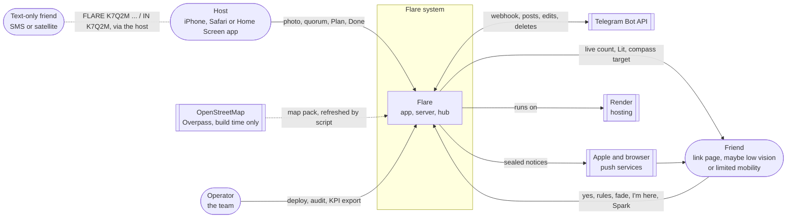
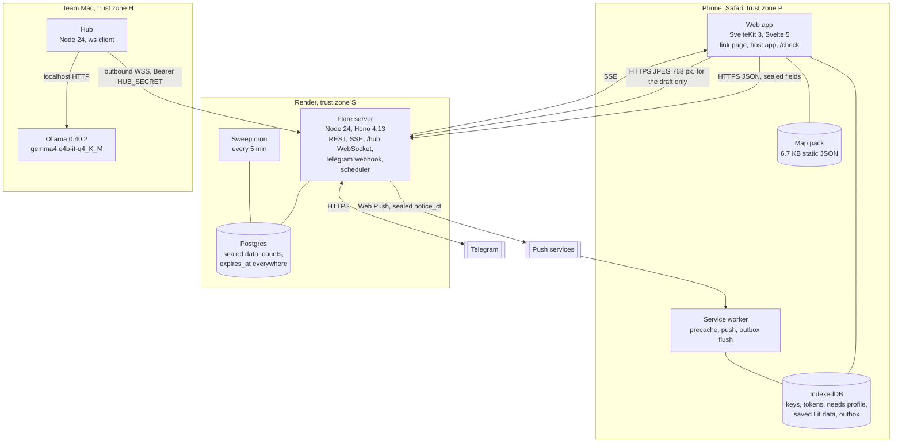
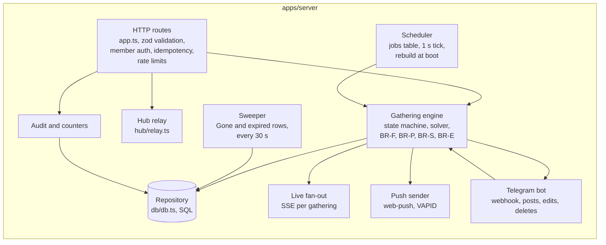
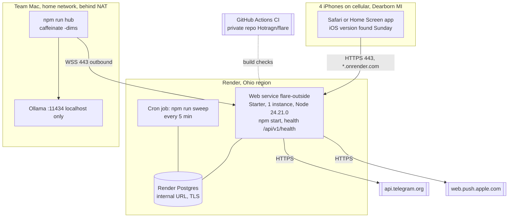

# Flare: System architecture

Version 1.0, Sat 2026-10-10. Owner: Architect. Structure: arc42 sections 1 to 9, condensed, with C4 diagrams (context, containers, components) and a deployment diagram. Decisions are in [adr/](adr/README.md); contracts in [contracts/](contracts/).

## 1. Goals and constraints

| Goal | Measure | Source |
| --- | --- | --- |
| Friends answer in private | No response shows who said yes or when | BR-Q-5, SRS-RES-4 |
| The server can't read what friends share | No readable name, place, coordinate, photo or condition from a link group reaches the server or its logs | FR-PRIV-1, ADR-0008, ADR-0009 |
| Everything about a gathering is gone 5 min after it ends | Deletion audit prints 0 | BR-D-1, SRS-PRIV-5 |
| Fast on an iPhone 13 | Link page interactive ≤ 2.0 s on 4G; ≤ 150 KB gzipped JS | SRS-PERF-1, -2 |
| Works with no signal once lit | Lit screen and compass in airplane mode | SRS-OFF-2 |
| Open models only | Gemma 4 E4B on our Mac via Ollama | BRD constraint |

Constraints: no accounts; four test iPhones with unknown iOS versions (capability detection only); one weekend; every public action waits for the founder.

## 2. Context (C4 level 1)

## 3. Containers (C4 level 2)

| Container | Tech (versions in ADR-0001) | Owns | Never holds |
| --- | --- | --- | --- |
| Web app | SvelteKit 3.0.1 static build, Bits UI 2.19.5, WebCrypto | Keys, sealing, rules parser, needs checks, map pack, compass, outbox | Other members' answers |
| Service worker | SvelteKit `$service-worker` | Precache, push display, outbox flush on open | Anything not already in IndexedDB |
| Flare server | Hono 4.13.13, ws 8.22.0, pg 8.23.1, pino 10.4.0, zod 4.6.5 | State machine, solver, timers, fan-out, bot, deletion | Group keys, readable places, names, conditions, needs, photos (beyond a request) |
| Postgres | Render Postgres | Sealed blobs, answers as rules, counts, tokens as hashes | Columns named lat, lon, spot, name (schema test) |
| Hub | Node 24, ws client, no `fs` | AI jobs in memory | Anything on disk |
| Ollama | 0.40.2, GGUF Q4_K_M | The model | Request history |

## 4. Components of the server (C4 level 3)

| Component | Path | Rules it implements | Built now |
| --- | --- | --- | --- |
| HTTP routes | `src/app.ts`, `src/routes/*` | SRS-IF-1, SRS-SEC-4, -5, -6 | Health, drafts |
| Hub relay | `src/hub/relay.ts` | ADR-0006, ADR-0011 | Yes, tested |
| Gathering engine | `src/engine/*` (pure functions: `solve()`, `transition()`) | BR-Q, BR-S, BR-F, BR-P, BR-E, BR-H | Engineering |
| Scheduler | `src/engine/scheduler.ts` | BR-F-8, SRS-ST-2 | Engineering |
| Sweeper | `src/db/sweep.ts`, `npm run sweep` | BR-D-1, BR-D-2 | Engineering |
| Live fan-out | `src/live/sse.ts` | SRS-SOL-3 | Engineering |
| Push sender | `src/live/push.ts` | SRS-IF-3, ADR-0014 | Engineering |
| Telegram bot | `src/telegram/*` | contracts/telegram.md | Engineering |
| Audit and counters | `src/audit.ts` | BR-D-7, SRS-PRIV-6 | Engineering |
| Repository | `src/db/db.ts`, `migrations/` | ADR-0004 | Schema, migrate, tests |

The engine is pure: `(state, event, now) → (state, effects)`. Effects (send push, post to Telegram, schedule a job) are executed by the caller after the transaction commits. That keeps the solver deterministic (BR-S-5) and unit-testable without a database.

## 5. Components of the web app

| Module | Path (target) | Job |
| --- | --- | --- |
| Crypto | `src/lib/crypto/seal.ts` | Key import, seal and open with AAD (ADR-0008), place hash |
| Store | `src/lib/store/*.ts` | IndexedDB (idb 8.0.4): keys, tokens, saved Lit data, outbox |
| API client | `src/lib/api/*.ts` | Typed calls per openapi.yaml, idempotency keys, outbox |
| Live | `src/lib/live.ts` | SSE plus 30 s poll, server-time offset |
| Conditions | `src/lib/conditions/parse.ts` | Rules parser (lab 07: 40/40 core), read-back |
| Needs | `src/lib/needs/*.ts` | BR-A-2 checks on the map pack, per label |
| Map | `src/lib/map/pack.ts` | Map pack load, nearest named feature, Ember candidates |
| Compass | `src/lib/compass/*.ts` | Geolocation, orientation, speech, haptics |
| Photo | `src/lib/photo.ts` | 768 px JPEG for the draft (built now) |
| Screens and components | from `design/prototype/src/lib/` | 33 screens, copy deck, tokens, motion |

## 6. Deployment

| Setting | Value |
| --- | --- |
| Build | `npm ci && npm run build` |
| Start | `npm start` (`node apps/server/src/main.ts`) |
| Env (server) | `PUBLIC_BASE_URL`, `DATABASE_URL`, `HUB_SECRET`, `TELEGRAM_*`, `VAPID_*` (checked by `npm run check-env -- server bot`) |
| Env (hub) | `FLARE_SERVER_URL=wss://…`, `HUB_SECRET`, `OLLAMA_URL`, `OLLAMA_MODEL` |
| TLS | Render-managed certificate; HSTS from the app |
| Instances | 1 (relay and SSE are in memory; ADR-0005) |

Deploying, the cron job, the paid plan and the Telegram webhook all wait for the founder's yes.

## 7. Cross-cutting concepts

| Concern | Approach | Detail |
| --- | --- | --- |
| Privacy | Seal on the phone, labels for places, counts only | [08-security-privacy.md](08-security-privacy.md) |
| Deletion | Cascade, expires_at, sweeper, cron, audit | ADR-0004, [06-erd-and-data-dictionary.md](06-erd-and-data-dictionary.md) |
| Time | Server clock decides; views carry `server_time`; phones display the offset-corrected time | BR-TIME-1 to 3 |
| Idempotency | Every write has a key; outbox retries | ADR-0010 |
| Offline | Service worker, map pack, saved Lit data | [07-offline-sync-and-ai.md](07-offline-sync-and-ai.md) |
| AI | Hub for photos and ladders, rules on the phone | ADR-0007 |
| Errors | Typed `Error.code` per contract; the phone maps codes to copy deck strings | contracts/openapi.yaml |
| Observability | Redacted logs, counters, health, audit | [09-observability.md](09-observability.md) |
| Accessibility | WCAG 2.2 AA, axe in CI for every screen | [12-testing-strategy.md](12-testing-strategy.md) |

## 8. Quality scenarios

| Scenario | Response | Measure |
| --- | --- | --- |
| The Mac sleeps mid-test | Health shows `hub: absent`; drafts return the template in ≤ 6 s; the host types six words | No P0 flow blocked |
| Render restarts during Kindling | Hub reconnects (1 to 30 s); phones' SSE reconnects; scheduler rebuilds timers from `jobs` | Timer fires within 30 s of schedule (SRS-ST-2) |
| A friend loses signal after Lit | Saved Lit data and compass work; taps queue in the outbox | "Offline. Saved at {time}." |
| 12 friends tap within 1 s | Each yes is one transaction with `SELECT … FOR UPDATE` on the gathering; the solver runs in under 5 ms for 12 (exhaustive, BR-S-4) | p95 ≤ 300 ms (SRS-PERF-3) |
| A database row survives Gone | The audit counts it; the cron sweep deletes it within 5 min | Audit 0 |

## 9. Risks and technical debt

| Risk | Mitigation |
| --- | --- |
| iPhone 13 shader frame rate unknown | Frame-time gate falls back to CSS (ADR-0003); measure Sunday |
| iOS Web Push needs Home Screen install | Telegram post and open page carry Lit too (AS-1) |
| One server instance | Fine for the test; LISTEN/NOTIFY path documented in ADR-0005 |
| Telegram groups readable by Telegram | Disclosed before adding the bot (ADR-0013) |
| Free Render Postgres expires in 30 days | Paid plan or recreate; founder decides with the deploy |
