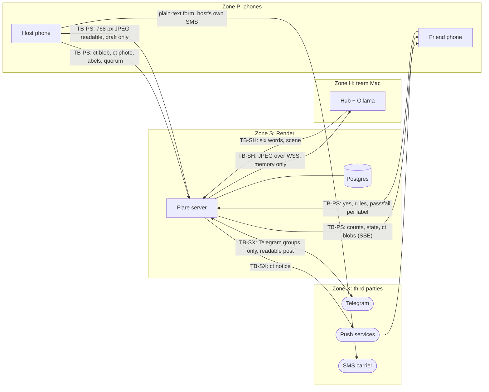
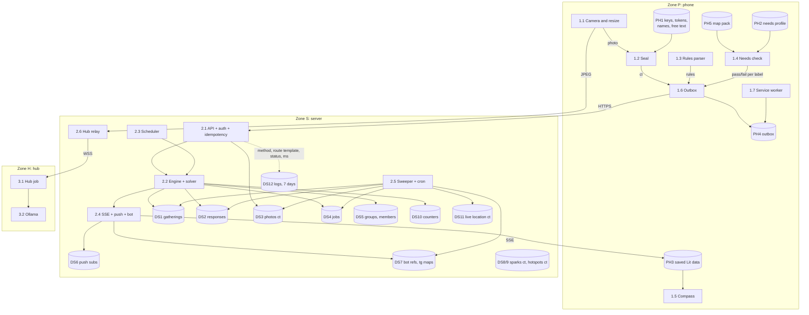
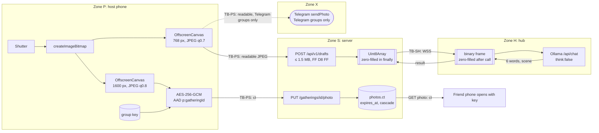
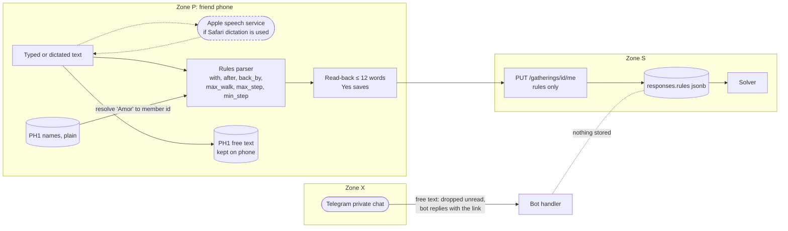
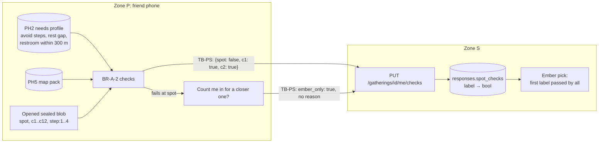
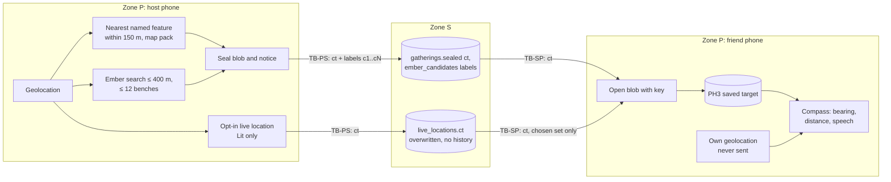
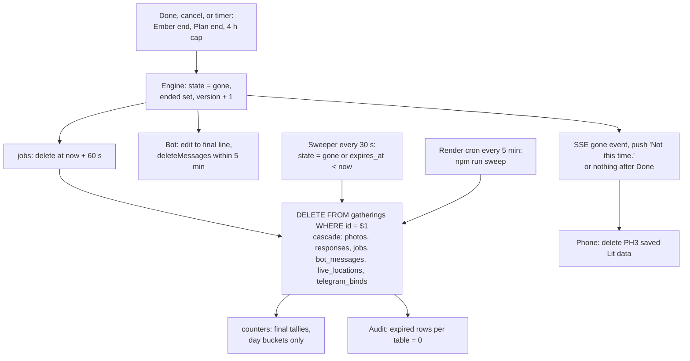

# Flare: Physical data flow diagrams

Version 1.0, Sat 2026-10-10. Owner: Architect. Maps the analyst's logical DFD ([04-data-flow-and-dictionary.md](../requirements/04-data-flow-and-dictionary.md)) onto real processes, stores and wires. Level 0 is the whole system, level 1 the containers, level 2 one diagram for each sensitive flow: photo, conditions, needs profile, location, deletion.

## Trust zones

| Zone | What runs there | Who controls it | Trust |
| --- | --- | --- | --- |
| **P** Phone | Web app, service worker, IndexedDB | The person | Trusted with their own data and the group key |
| **S** Server | Render web service, Postgres, cron | Us, on Render's hardware | Trusted to run code honestly; **not** trusted with readable content. Designed so a full database dump reveals no names, places, photos or conditions of a link group |
| **H** Hub | Team Mac: hub process, Ollama | Us | Sees one photo at a time in memory; keeps nothing |
| **X** Third parties | Telegram, Apple and browser push services, the friend's SMS carrier, Overpass at build time | Them | Untrusted. Push services get ciphertext; Telegram gets what Telegram groups chose to post |

Boundaries are drawn as `=== TB` labels. Every arrow that crosses one is TLS 1.2+ (HTTPS or WSS), except SMS, which the host sends from their own phone.

Notation: `[process]`, `[(store)]`, `([external])`. `ct` = sealed with the group key (AES-256-GCM).

## Level 0

## Level 1

## Level 2: photo

| Flow | Crosses | Data | Stored | Deleted |
| --- | --- | --- | --- | --- |
| Draft photo | P→S→H | Readable 768 px JPEG | Nowhere (memory, zero-filled) | End of request (ADR-0011) |
| Shared photo | P→S | Ciphertext | `photos.ct` | Cascade at Gone, expiry backstop |
| Telegram photo | P→S→X | Readable 768 px JPEG | Telegram's servers | We delete the message at Gone; Telegram's own retention applies |
| Six words, scene | H→S→P | Readable text | Not on the server; sealed into the blob by the phone | With the blob |

## Level 2: conditions

Free text never crosses TB-PS (SRS-COND-6). Proof to build: a Playwright test that types a condition and asserts no request body contains the typed words (12-testing-strategy.md, T-PRIV-2). Dictation in Safari may use Apple's servers; the mic prompt says so (handoff 06, decision 11).

## Level 2: needs profile

The server learns, per label, whether some member's checks passed. It never learns which need failed or why (SRS-ACC-4). Small groups may guess; P6 says so (R19).

## Level 2: location

The friend's own position never leaves their phone: walking time and `max_walk` are checked locally and reported as pass or fail (BR-C-7). No arrow carries a coordinate in readable form across TB-PS (ADR-0009).

## Level 2: deletion

| Store | Removed by | Worst case |
| --- | --- | --- |
| DS1 to DS4, DS7 refs, DS11 | Cascade from `gatherings` | 60 s after Gone; 5 min if the web service is down (cron) |
| Telegram messages | `deleteMessages` | 5 min, 3 retries |
| Phone PH3 | Phone on learning Gone | 24 h after Lit if the phone never comes online |
| Logs DS12 | Render | 7 days; contain no ids or content |
| Preview caches (iMessage, WhatsApp, Telegram) | Out of our reach | Hold only the brand card and a count (ADR-0017) |
