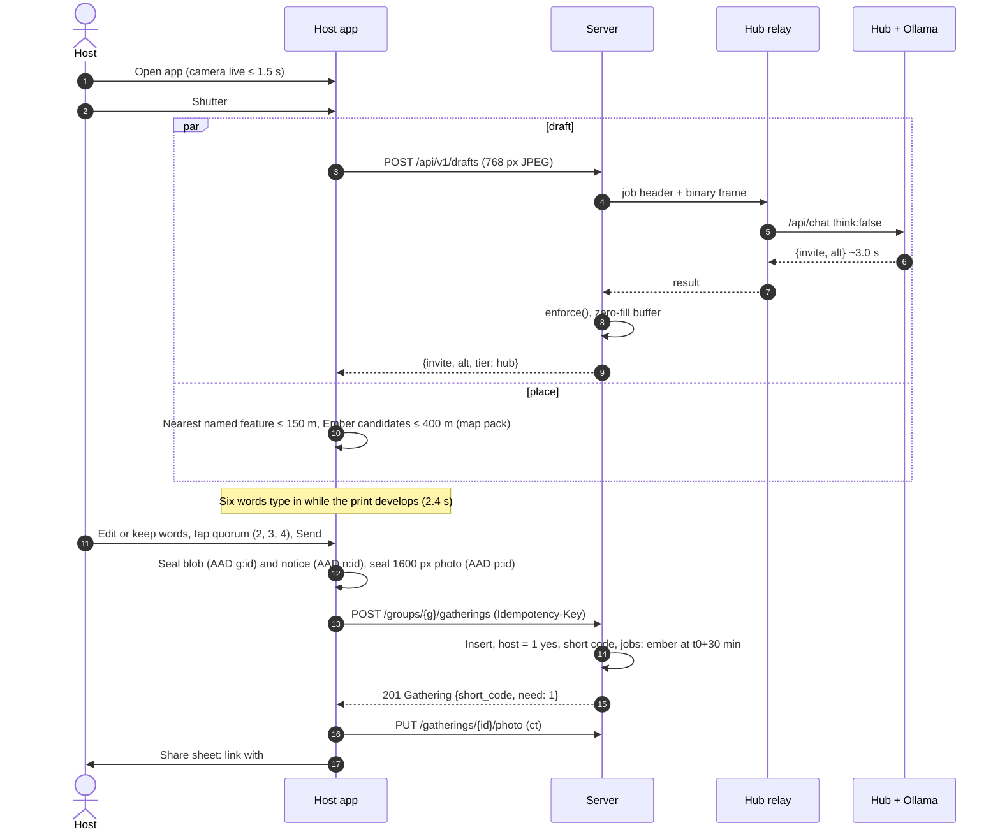
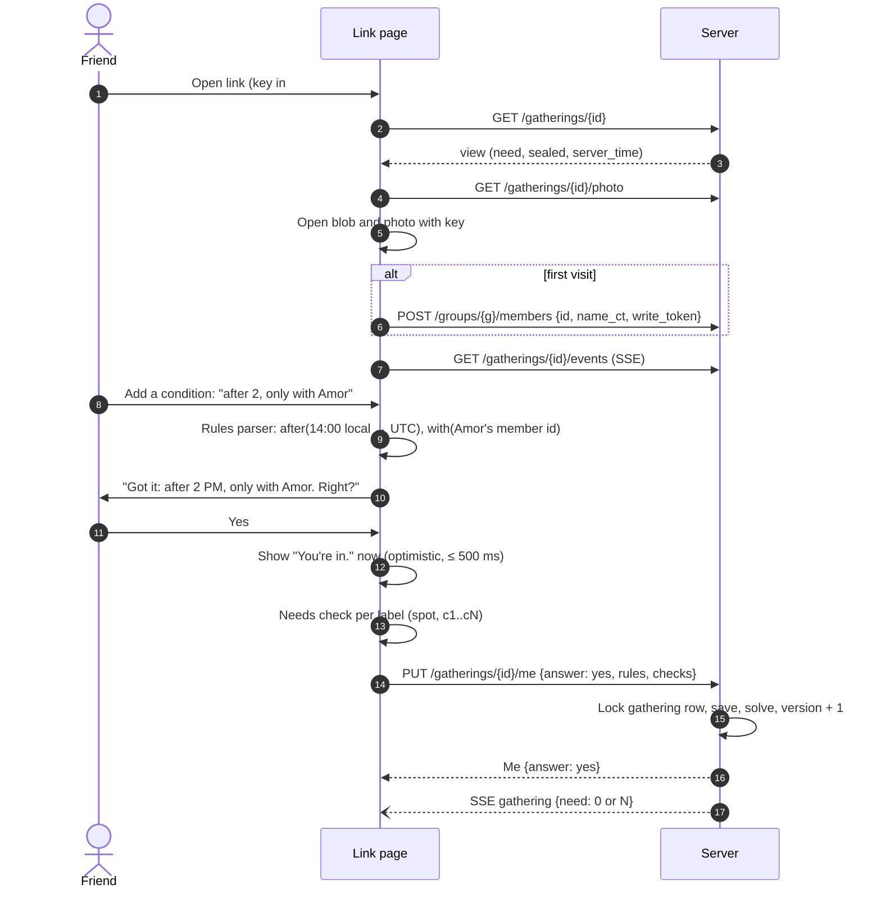
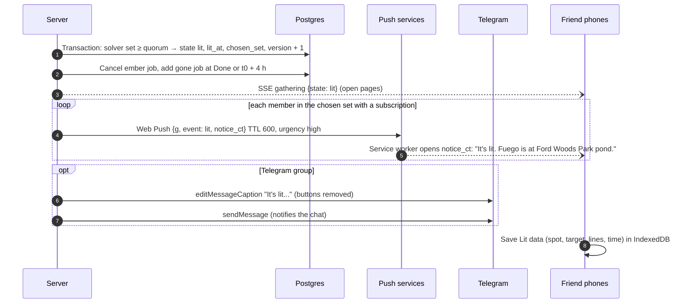
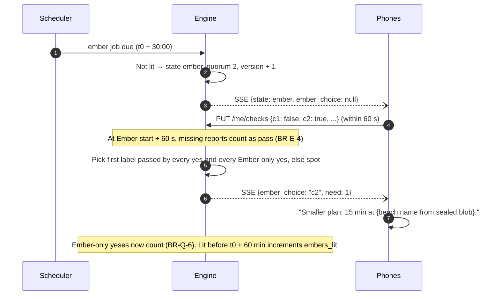
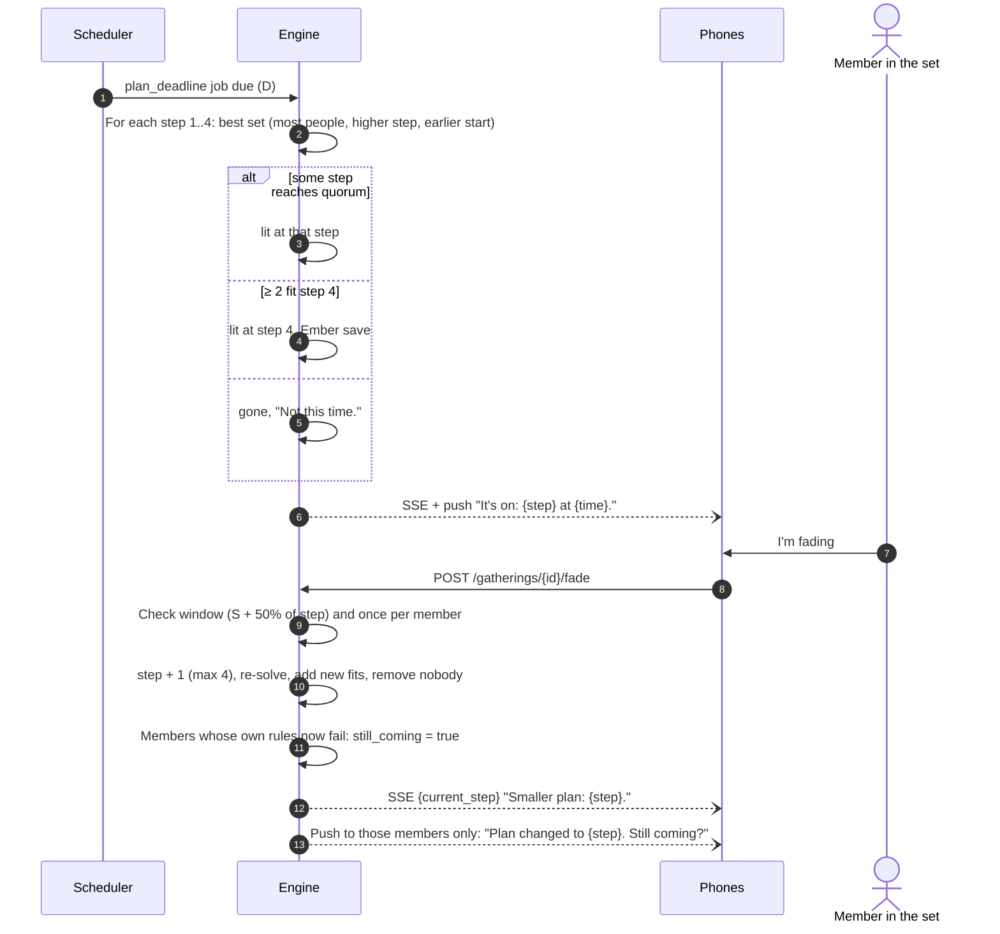
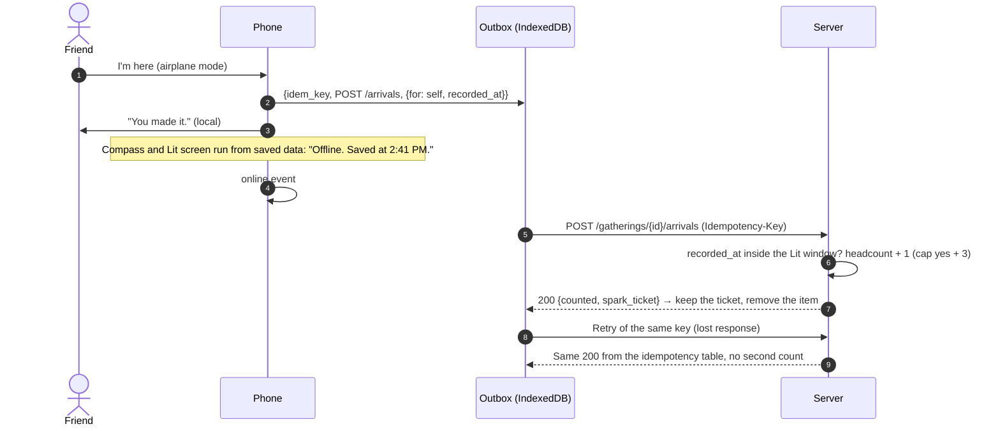
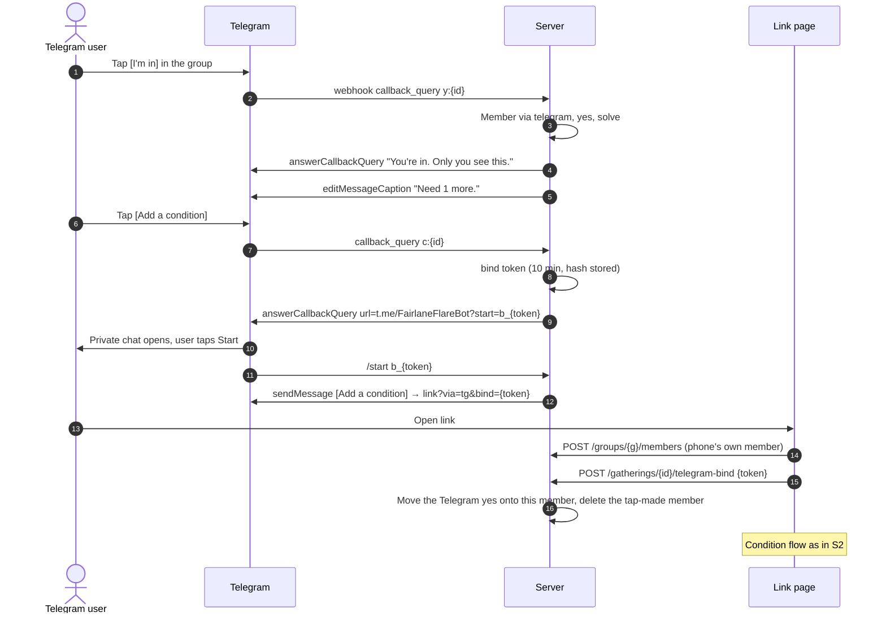
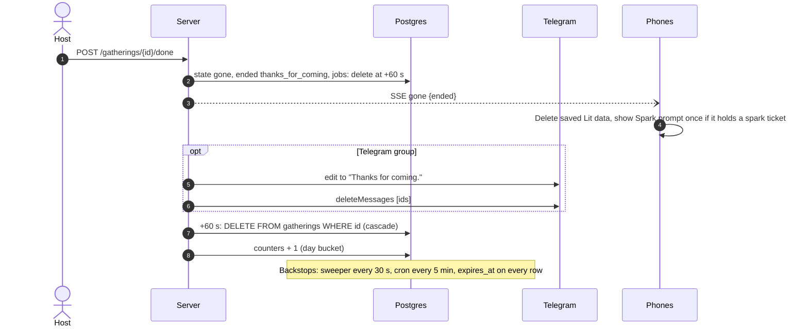
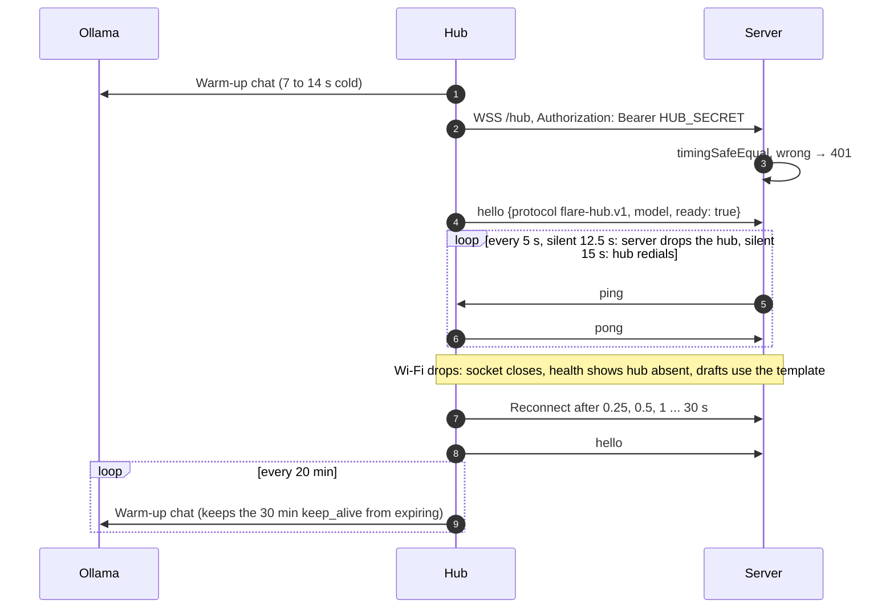

# Flare: Sequence diagrams

Version 1.0, Sat 2026-10-10. Owner: Architect. Endpoints and messages refer to [openapi.yaml](contracts/openapi.yaml) and [asyncapi.yaml](contracts/asyncapi.yaml). Times are budgets from the SRS.

## S1. Send a Flare (SRS-CRE-1 to 9, median ≤ 15 s)

If the hub is absent or misses 6 s, step 8 returns `tier: rules` with the template and the app shows the typed six-word field with map-pack chips.

## S2. A friend says yes with a condition (SRS-RES-3, SRS-COND-5, ≤ 10 s)

The typed words stay in IndexedDB on the friend's phone. Only the two rules cross the network.

## S3. It lights (SRS-LIT-1, ≤ 10 s to every member of the set)

## S4. Shrinks to an Ember (BR-F-3, BR-E-1 to 6)

## S5. A Plan solves at the deadline, then someone fades (BR-P-2 to 7)

## S6. I'm here with no signal (BR-H-5, SRS-OFF-3)

## S7. Telegram tap, then a condition (contracts/telegram.md)

## S8. Gone and deletion (BR-D-1 to 3)

## S9. Hub connects, drops, comes back (ADR-0006)

