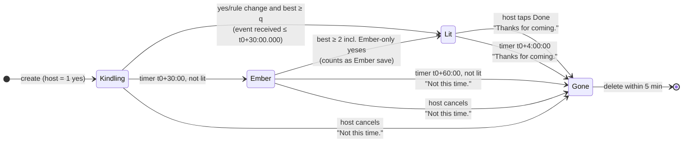
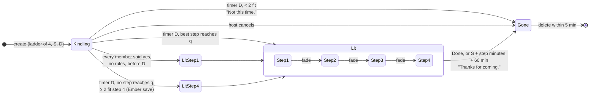
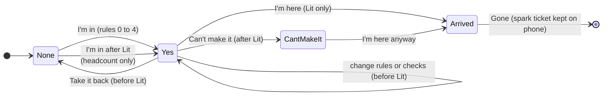
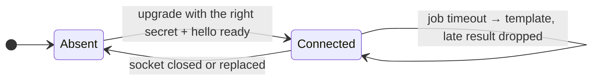

# Flare: State machines

Version 1.0, Sat 2026-10-10. Owner: Architect. Source rules: BR-F (Flare), BR-P (Plan), BR-E (Ember), BR-H (arrival). The server clock decides every transition (BR-TIME-1). The engine implements each machine as a pure function `transition(state, event, now) → {state, effects}`; the transition tables below are its test cases.

Notation: `t0` = server time the Flare was created; `S` = Plan start; `D` = Plan deadline; `best` = size of the solver's best set including the host; `q` = quorum.

## 1. Flare

| # | From | Event | Guard | To | Effects |
| --- | --- | --- | --- | --- | --- |
| F1 | none | create | quorum in {2, 3, 4}, group ≤ 12 | Kindling | host yes; short code; job `ember` at t0+30:00; expires_at t0+5 h |
| F2 | Kindling | yes, take-back, rule change, checks | solve(); best ≥ q; received ≤ t0+30:00.000 (BR-F-2) | Lit | lit_at; chosen_set; cancel `ember`; job `gone` at t0+4 h; push and bot "It's lit."; SSE |
| F3 | Kindling | same | best < q | Kindling | need = q − best; SSE; bot edit |
| F4 | Kindling | timer `ember` | not Lit | Ember | quorum = 2; job `ember_pick` at +60 s; job `gone` at t0+60:00; push and bot "Smaller plan: 15 min at {bench}." |
| F5 | Ember | checks or timer `ember_pick` | missing checks count as pass after 60 s (BR-E-4) | Ember | ember_choice = first label passed by all, else `spot` |
| F6 | Ember | any answer event | solve() with Ember-only yeses (BR-Q-6), best ≥ 2 | Lit | as F2; counter `embers_lit` + 1 |
| F7 | Ember | timer `gone` | not Lit | Gone | ended = not_this_time; push "Not this time." |
| F8 | Kindling or Ember | host cancel | host only | Gone | ended = not_this_time |
| F9 | Lit | host Done, or timer `gone` (t0+4 h) | | Gone | ended = thanks_for_coming; Spark prompt on phones with a ticket |
| F10 | Lit | yes from a new member | | Lit | counts toward headcount cap only (BR-H-4); nobody leaves the set (BR-F-7) |
| F11 | Lit | "Can't make it" | | Lit | answer cant_make_it; state unchanged (SRS-RES-6) |
| F12 | Lit | take-back | | Lit | refused: 409 `already_lit` |
| F13 | Gone | any | | Gone | 410 `gone` |
| F14 | Gone | timer `delete` (+60 s) or sweeper | | deleted | cascade delete; counters |

Race rule (BR-F-2): an answer and the `ember` timer both lock the gathering row (`SELECT … FOR UPDATE`). The answer wins if its server receive time is ≤ t0 + 30:00.000, even when the timer job is already running; the timer re-reads the state after taking the lock and does nothing if Lit.

## 2. Plan

| # | From | Event | Guard | To | Effects |
| --- | --- | --- | --- | --- | --- |
| P1 | none | create | D ≥ now+10 min; D ≤ S−10 min; S ≤ now+36 h (BR-P-1); 4 steps, minutes strictly decreasing (BR-P-4); quorum 2 to 6 | Kindling | job `plan_deadline` at D; expires_at S+24 h |
| P2 | Kindling | answers | every member yes with no rules, before D (BR-P-2) | Lit, step 1 | as F2 |
| P3 | Kindling | answers | otherwise | Kindling | need at the highest step that could still light (BR-Q-4, SRS-PLAN-11) |
| P4 | Kindling | timer D | max over steps of best ≥ q; pick by people, then higher step, then earlier start (BR-S-1) | Lit, step k | current_step = k; job `gone` at S + minutes(k) + 60 min; push "It's on: {step} at {time}." |
| P5 | Kindling | timer D | no step reaches q; ≥ 2 fit step 4 (BR-P-3) | Lit, step 4 | Ember save counter; push "Smaller plan: {step} at {time}." |
| P6 | Kindling | timer D | < 2 fit any step | Gone | "Not this time." |
| P7 | Lit, step k < 4 | fade by a set member | once per member; now ≤ S + 50% of minutes(k) (BR-P-5) | Lit, step k+1 | re-solve, add fits, remove nobody (BR-P-6); still_coming for members whose rules fail (ADR-0016); "Smaller plan: {step}." (BR-P-7); move `gone` job |
| P8 | Lit, step 4 | fade | same guards | Lit, step 4 | fade recorded; no step change (BR-P-6 "never below 4") |
| P9 | Lit | fade | guard fails | Lit | 409 `fade_used` or `fade_window_closed` |
| P10 | Lit | Done or timer `gone` | | Gone | thanks_for_coming |
| P11 | Kindling | host cancel | | Gone | not_this_time |

## 3. One member's answer

Arrival rules: headcount = 1 + arrivals (BR-H-1), capped at yes-count + 3 (BR-H-4); a self "I'm here" and a host +1 for the same member count once (BR-H-3); outbox arrivals count if `recorded_at` is inside the Lit window (BR-H-5).

## 4. Hub connection (server view)

`/api/v1/health` reports `hub: connected` only in Connected with `ready: true`.
