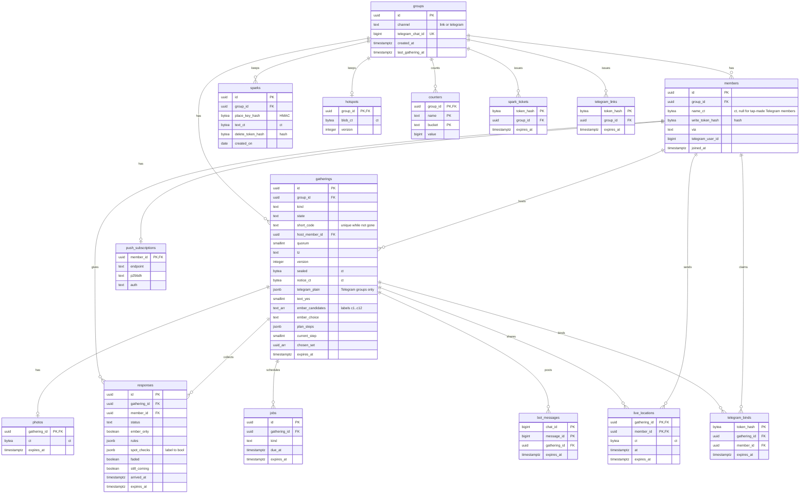

# Flare: ERD and data dictionary

Version 1.0, Sat 2026-10-10. Owner: Architect. Physical model for PostgreSQL ([ADR-0004](adr/0004-storage-postgres.md)). Source of truth: [apps/server/src/db/migrations/0001_init.sql](../../apps/server/src/db/migrations/0001_init.sql). Logical stores DS1 to DS12 are from the analyst's dictionary ([04-data-flow-and-dictionary.md](../requirements/04-data-flow-and-dictionary.md)); changes from it are listed in section 4.

Types: `uuid` = UUID v4 made on the phone (ADR-0018); `ct` = `bytea` holding AES-256-GCM ciphertext from a phone (12-byte nonce first); `hash` = `bytea` SHA-256 of a 128-bit token.

## 1. ERD

Not drawn (no foreign keys): `global_counters (name, bucket, value)`, `idempotency (key, response, expires_at)`, `schema_migrations (name, applied_at)`.

## 2. Data dictionary

### Per-gathering tables (deleted at Gone; every row has `expires_at`)

| Table | Column | Type | Rules | Notes |
| --- | --- | --- | --- | --- |
| gatherings (DS1) | id | uuid | PK, made by the host's phone | AAD for its sealed fields |
| | group_id | uuid | FK groups, cascade | |
| | kind | text | `flare` or `plan` | |
| | state | text | `kindling`, `lit`, `ember`, `gone` | 04-state-machines.md |
| | short_code | text | 5 of the BR-CH-3 alphabet; partial unique index while not gone | |
| | host_member_id | uuid | FK members, cascade | Counts as 1 yes (BR-Q-1) |
| | quorum | smallint | 2 to 4 Flare, 2 to 6 Plan; set to 2 at Ember | |
| | tz | text | IANA name from the host's phone | BR-TIME-2 |
| | version | integer | + 1 on every change | SSE event id, ETag |
| | state_since | timestamptz | | |
| | ended | text | `not_this_time`, `thanks_for_coming` | Same for every member (SRS-ST-3) |
| | sealed | ct | ≤ 16 KB plaintext; AAD `g:{id}` | host name, six words, scene, host line, spot, candidates, steps, access and nature lines |
| | notice_ct | ct | ≤ 2,100 bytes; AAD `n:{id}` | Copied into push payloads (ADR-0014) |
| | telegram_plain | jsonb | Telegram groups only | `{host, invite, place, link, ember_places, step_names}` (ADR-0013) |
| | text_yes | smallint | 0 to 3 | Anonymous yeses (BR-ID-6) |
| | ember_candidates | text[] | labels `c1`..`c12` in distance order | Places only in `sealed` (ADR-0009) |
| | ember_choice | text | a label or `spot` | |
| | plan_steps | jsonb | `[{step, minutes, place}]`, 4 items, minutes strictly decreasing | Names only in `sealed` |
| | current_step | smallint | 1 to 4 | Plans |
| | chosen_set | uuid[] | Solver output | Never sent to clients (SRS-PRIV-8) |
| | created_at, deadline_at, start_at, lit_at, done_at | timestamptz | Server clock | |
| | headcount | smallint | 1 + arrivals, ≤ yes + 3 | BR-H-1, BR-H-4 |
| | expires_at | timestamptz | t0 + 5 h (Flare), S + 24 h (Plan) | BR-D-2 |
| photos (DS3) | gathering_id | uuid | PK, FK cascade | |
| | ct | ct | ≤ 1.5 MB; AAD `p:{id}` | 1600 px JPEG q0.8 before sealing |
| responses (DS2) | id | uuid | PK, server-made | |
| | gathering_id, member_id | uuid | FKs cascade; unique pair | |
| | status | text | `yes`, `taken_back`, `cant_make_it` | |
| | ember_only | boolean | | BR-A-3, carries no reason |
| | rules | jsonb | 0 to 4 of `with`, `after`, `back_by`, `max_walk`, `max_step`, `min_step` | No free text (BR-C-9) |
| | spot_checks | jsonb | label → bool | BR-E-3, SRS-PLAN-6 |
| | faded | boolean | once per Plan | BR-P-5 |
| | still_coming | boolean | | ADR-0016 |
| | arrived_at | timestamptz | Lit window only | BR-H-5 |
| jobs (DS4) | kind | text | `ember`, `ember_pick`, `gone`, `plan_deadline`, `delete` | Rebuilt into memory at boot; 1 s tick |
| | due_at | timestamptz | | Fires within 30 s (SRS-ST-2) |
| bot_messages (DS7 refs) | chat_id, message_id | bigint | PK | Deleted after `deleteMessages` |
| live_locations (DS11) | ct | ct | AAD `l:{gathering id}`; overwritten in place | Host only, Lit only (SRS-CMP-6) |
| telegram_binds | token_hash | hash | 10 min | ADR-0013 |

### Group tables (survive Gone; BR-D-4 and BR-D-5)

| Table | Column | Type | Rules | Retention |
| --- | --- | --- | --- | --- |
| groups (DS5) | id | uuid | PK, phone-made | Until the last member forgets it (ADR-0015) or 180 days without a gathering |
| | channel | text | `link`, `telegram` | |
| | telegram_chat_id | bigint | unique | |
| | last_gathering_at | timestamptz | | Drives the 30 and 180 day sweeps |
| members (DS5) | name_ct | ct | AAD `m:{group}:{member}`; ≤ 150 bytes | Until "Forget this group" |
| | write_token_hash | hash | | |
| | via, telegram_user_id | text, bigint | DS7 map | `telegram_user_id` set to null after 30 days without a gathering (BR-ID-5) |
| push_subscriptions (DS6) | endpoint, p256dh, auth | text | | Deleted 30 days after the group's last gathering, or on 404/410 from the push service |
| sparks (DS8) | place_key_hash | HMAC-SHA-256 | key from HKDF(group key) | 180 days without a gathering |
| | text_ct | ct | AAD `s:{group}:{spark}`; 1 to 140 characters before sealing | |
| | delete_token_hash | hash | | Lets the writer delete it (ADR-0015) |
| | created_on | date | day only | |
| spark_tickets | token_hash | hash | single use | 24 h after Gone |
| hotspots (DS9) | blob_ct | ct | AAD `h:{group}`; If-Match on `version` | 180 days without a gathering |
| counters (DS10) | name, bucket, value | | Exactly the counters in 07-kpis.md; day buckets at most | With the group |
| telegram_links | token_hash | hash | 15 min, single use | |

### System tables

| Table | Notes |
| --- | --- |
| global_counters | `tier_ran.{job}.{tier}` totals (BR-AI-3); no group, no time |
| idempotency | `{memberId or anon}:{key}` → first response, 24 h (SRS-REL-2) |
| schema_migrations | Applied migration names |

### Columns that must never exist

`apps/server/test/db.test.ts` fails if any table except `schema_migrations`, `counters` and `global_counters` has a column named `lat`, `lon`, `latitude`, `longitude`, `spot`, `place_name` or `name`, and if `sparks` has a `member_id` or a timestamp finer than a day.

## 3. Deletion audit mapping (BR-D-7)

| Logical store | Table | Per gathering | Audit counts |
| --- | --- | --- | --- |
| DS1 | gatherings | yes | rows with `expires_at < now()` or `state = 'gone'` older than 5 min |
| DS2 | responses | yes | rows with `expires_at < now()` |
| DS3 | photos | yes | same |
| DS4 | jobs | yes | same |
| DS7 refs | bot_messages | yes | same |
| DS11 | live_locations | yes | same |
| (new) | telegram_binds | yes | same |
| DS5 | groups, members | no | totals; members of groups past 180 days |
| DS6 | push_subscriptions | no | totals; rows past 30 days |
| DS7 map | members.telegram_user_id | no | non-null past 30 days |
| DS8, DS9 | sparks, hotspots | no | totals; past 180 days |
| DS10 | counters | no | totals |
| DS12 | Render logs | n/a | `npm run audit:logs -- <file>` greps an exported log for any UUID or short code; passing = 0 |

## 4. Changes from the logical dictionary

| Logical | Physical | Why |
| --- | --- | --- |
| `spot {place_key, name_ct, lat, lon}`, ladder `lat, lon`, `ember_spot {bench_osm_id, lat, lon}` | Inside `sealed`; server keeps labels only | ADR-0009 |
| `invite_ct`, `scene_ct`, `host_line_ct` | One `sealed` blob | One seal, one AAD, fewer columns |
| `blur_preview` | Dropped | ADR-0017 |
| DS2 `member_id` null for text yeses | `gatherings.text_yes` count | No row needed for an anonymous yes |
| DS2 `idem_keys`, `write_token_hash` | `idempotency` table; token hash on `members` | One token per member, not per answer |
| DS11 `lat, lon` | `ct` | ADR-0009 |
| id128 base32 | UUID v4 | ADR-0018 |
| (none) | `notice_ct`, `version`, `ended`, `still_coming`, `spark_tickets`, `telegram_links`, `telegram_binds`, `global_counters` | ADR-0014, ADR-0016, ADR-0013, BR-K-1 after deletion |
