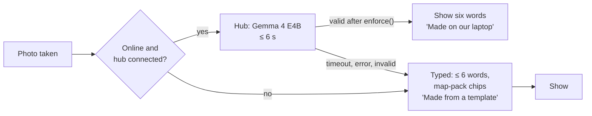

# Flare: Offline, sync and AI placement

Version 1.0, Sat 2026-10-10. Owner: Architect. Decisions: [ADR-0010](adr/0010-offline-first.md) (offline), [ADR-0007](adr/0007-ai-placement.md) (AI), [ADR-0014](adr/0014-live-updates-sse-and-sealed-push.md) (live updates).

## Part A. Offline and sync

### A1. What works with no signal

| Situation | Works | How |
| --- | --- | --- |
| App opened before, now offline | App shell, all screens | Service worker precache (SvelteKit `$service-worker` build + files lists) |
| Lit, then signal lost | Lit screen, compass, speech, access and nature lines, "I'm here" | Saved Lit data in IndexedDB; compass needs only GPS and the saved target (SRS-CMP-7) |
| Host with no signal wants to send | Photo, typed six words, place name, plain-text form | Map pack; no hub; "Copy as text" shares the SMS form; the Flare itself is created when the outbox reaches the server |
| Friend with no data at all | Reads the SMS, replies `IN K7Q2M` to the host | Plain-text form (contracts/plain-text.md) |
| Link never opened online | Nothing | Needs one online open; the SMS form covers this friend |

### A2. Phone stores (IndexedDB database `flare`, version 1)

| Object store | Key | Contents | Lifetime |
| --- | --- | --- | --- |
| `groups` | groupId | raw key bytes wrapped as non-extractable CryptoKey, memberId, write token, display names (opened) | Until "Forget this group" |
| `needs` | `profile` | Needs profile (BR-A-1) | Until cleared |
| `conditions` | gatheringId | Free text the person typed (never sent) | Until Gone |
| `lit` | gatheringId | Saved Lit data: spot, target lat/lon, access line, host line, nature line, state time, `server_time` offset | Gone or Lit + 24 h |
| `outbox` | idemKey | `{method, path, body, recorded_at, attempts}` | Until 2xx/4xx or 24 h |
| `tickets` | gatheringId | Spark ticket | Used or 24 h after Gone |
| `seen` | gatheringId | Last view version | Until Gone |

### A3. Outbox protocol

1. Every write builds `{idemKey: random 16 bytes base64url, method, path, body, recorded_at: Date.now()}` and stores it **before** the request.
2. The UI updates at once (optimistic; "You're in." ≤ 500 ms, SRS-RES-3).
3. Send now if online. On 2xx: store any response data (tickets), delete the item. On 4xx: delete it and show the mapped copy (for example `already_lit` → "It's already lit."). On 5xx or network error: keep it.
4. Flush order is creation order, one at a time, so a take-back can't overtake its yes.
5. Triggers: `online` event, `pageshow`, `visibilitychange` to visible, and a 15 s timer while visible. Safari has no Background Sync, so a closed app sends on next open.
6. Items older than 24 h are dropped and the person is told once: "Some taps didn't send."
7. The server stores `{memberId}:{idemKey}` → first response for 24 h; replays get the same response and `Idempotent-Replay: true` (SRS-REL-2).
8. Arrivals carry `recorded_at`; the server accepts them if that time is inside the Lit window, even when they arrive after Gone, up to the moment the gathering row is deleted (BR-H-5). After deletion they get 410 and are dropped.

### A4. Live view sync

- On open: `GET /gatherings/{id}` → render; then SSE `/events` with `Last-Event-ID: {seen version}`.
- Every view has `version` and `server_time`. Phones keep `offset = server_time − Date.now()` (smoothed over the last 5 views) and show times and countdowns from `Date.now() + offset` (BR-TIME-3). They never decide transitions.
- A view with a lower version than `seen` is ignored.
- While visible, poll every 30 s as a backstop; on `gone`, close SSE, delete `lit` and `conditions`, keep `tickets`.
- "Offline. Saved at {time}." shows when SSE has been down for 10 s and the last poll failed.

### A5. Map pack

- `apps/web/static/maps/fairlane.json`, built by `scripts/build-map-pack.ts` from the pinned Overpass query in docs/requirements/evidence/ (User-Agent `flare-outside/0.1 (+repo URL)`, overpass-api.de only).
- 128 features within 3 km of TEST_AREA (lab 05): benches, picnic tables, toilets, drinking water, steps, parks, natural features, named paths. Integer-micro-degree coordinates, short keys: 6.7 KB, 1.8 KB brotli.
- Carries `timestamp_osm_base`; the build fails if it is older than 7 days (SRS-IF-4, SRS-OFF-5). The app shows ODbL attribution on map-derived lines.
- Precached with the shell; served `Cache-Control: public, max-age=86400`.

## Part B. AI placement

### B1. Tiers

| Job | Phone | Hub | Template (floor) |
| --- | --- | --- | --- |
| Photo → six words + scene | Resize to 768 px only | Gemma 4 E4B, 3.0 s, 39/40 quality | Typed words with chips from the map pack (nearest named feature, amenity words); scene from map facts: "A bench near Ford Woods Park pond." |
| Conditions | Rules parser, 40/40 core, 15/20 hard | Not used (founder decision: no free text off the phone) | Rephrase hint |
| Plan ladder | Places from the map pack, sunset (NOAA), weather from api.weather.gov at 0.1° (ADR-0007) | Labels and minutes from ask + `{rain_likely, temp_f}`, ≤ 8 s | Step minutes = total × 1, 0.5, 0.25, 0.125, rounded to 5 (60 → 60, 30, 15, 10); labels from the copy deck |
| Needs, nature line, access line | Deterministic rules | Never | Never needed |
| Rest loop request (P1) | Rules parser | Never | Pickers |
| Fix the map tags (P1) | Photo resize | Gemma with the tag allow-list | Manual tag picker |

### B2. Validation (SRS-AI-2)

- Photo drafts: `enforce()` in `packages/shared/src/photo.ts` on the hub and again on the server. Clips the invite to 6 words and the scene to 20, strips emoji and `#`, rejects face words (faces, smiling, eyes, beard...) and identity words (man, woman, girl, he, she, elderly, teen, blonde, ethnicity terms...), the two regexes `FACE` and `IDENTITY`. Rejected → template. Lab 02 measured 0 person descriptions in 20 photos with this filter (SRS-AI-3).
- Ladder drafts: exactly 4 steps; minutes integers, strictly decreasing, each ≥ 5; labels ≤ 4 words and pass the same person filter.
- The tier shown to people is the tier that produced the final text (SRS-AI-4).

### B3. Model settings (lab 02)

`{model: "gemma4:e4b-it-q4_K_M", stream: false, think: false, keep_alive: "30m", options: {temperature: 0, seed: 42, num_predict: 128}}`, prompt v2 (`SYSTEM_PROMPT`, credited to the lab in photo.ts). Retry once on an unusable answer inside the budget. Warm at hub start and every 20 minutes.

### B4. Capability detection (SRS-AI-5, SRS-COMP-2)

The app checks features, never device names: `HTMLCanvasElement.prototype.toBlob`/`OffscreenCanvas` for resize, `'PushManager' in window` and `display-mode: standalone` for push, `DeviceOrientationEvent.requestPermission` for the compass on iOS, `speechSynthesis` for speech, `navigator.vibrate` or the iOS switch-overlay for haptics, WebGL2 plus a frame-time probe for the shader. `/check` shows each result with a timed test and "Copy report" (SRS-CAP-1).
