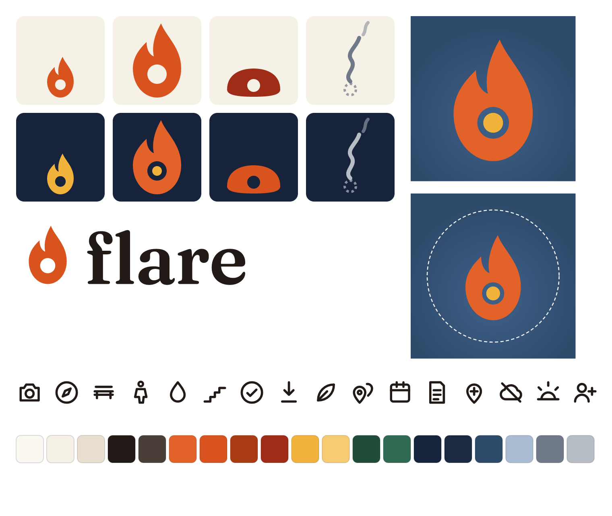

# Flare: Brand book

Version 1.0, Sat 2026-10-10. Every asset here is generated by `brand/tools/build.mjs` from `brand/tools/palette.mjs`. To change a color or shape, edit the source and run `npm run build` in `brand/tools`; never edit exported files by hand.



## 1. The mark

The mark is an **upside-down map pin**. A pin points down at a place; Flare's flame points up from it, with the pin's round hole at its base. It reads as "a place, lit." The hole is the one detail that makes it ours; never fill it.

| File | Use |
| --- | --- |
| `brand/logo/flare-mark-maple.svg` | Default on light backgrounds |
| `brand/logo/flare-mark-glow.svg` | Maple flame with a gold "you are here" dot; app icon, splash, dark backgrounds |
| `brand/logo/flare-mark-ink.svg` | One-color print, fax-grade, stamps |
| `brand/logo/flare-mark-birch.svg` | One-color on dark or photos |

Geometry (100-unit grid): flame from y 4 to 96; tongue notch on the left; hole centre (50, 67), radius 12; the gold dot is radius 6. The source path is `FLAME` in build.mjs.

### Wordmark
"flare", lowercase, **Fraunces SemiBold (600)**, tracking −1%, converted to outlines (no font needed). Files: `flare-wordmark-{ink,birch,maple}.svg`. The wordmark is always lowercase; in running text the product name is written "Flare".

### Lockups
| File | Use |
| --- | --- |
| `flare-lockup-horizontal-light.svg` | Site header, docs, light UI |
| `flare-lockup-horizontal-dark.svg` | Dark UI, slides (with gold dot) |
| `flare-lockup-horizontal-ink.svg`, `-birch.svg` | One-color |
| `flare-lockup-stacked-light.svg`, `-dark.svg` | Splash, square spaces, stickers |

Horizontal: the mark is 1.08 × the wordmark's ascender height and sits on the text baseline. Stacked: the mark is 1.6 × that, centred above the word.

### Clear space and minimum size
- **Clear space = one hole** (the hole's diameter, 24% of the mark's height) on every side. Nothing enters it: text, edges, other logos.
- **Minimum size:** mark 16 px (favicon) digital, 6 mm print. Horizontal lockup 96 px wide; stacked 64 px wide. Below 24 px use the plain maple mark, not the glow version (the dot disappears).

### Misuse (don't)
1. Don't fill, move or resize the hole.
2. Don't rotate, mirror or skew the flame. It leans right on purpose.
3. Don't add outlines, drop shadows, glows, bevels, gradients or glass blur.
4. Don't recolor outside the four approved colorways.
5. Don't put the maple mark on maple, gold or busy photos without a birch or dusk plate.
6. Don't retype the wordmark in another font or capitalize it.
7. Don't add sparkles, stars or "AI" glyphs near the mark.
8. Don't use the state marks (below) as the logo.

## 2. The four states

State is shown by **shape first, color second**, so it works in one color and for color-blind people.

| State | Shape | Light | Dark | Files |
| --- | --- | --- | --- | --- |
| Kindling | Small flame (55% size), same baseline | maple-600 | gold-400 | `brand/logo/states/flare-kindling-{light,dark,currentColor}.svg` |
| Lit | Full flame | maple-600 | maple-500 + gold dot | `flare-lit-*` |
| Ember | Low dome with a small hole | ember-700 | maple-600 | `flare-ember-*` |
| Gone | Dashed ring and a smoke wisp drifting up and right | smoke-500 | smoke-300 | `flare-gone-*` |

`currentColor` versions take their color from CSS, for UI use. Kindling's growth toward Lit is the main progress visual: the flame scales from 55% to 100% as "Need N more" counts down (product design sets the steps).

## 3. Color

Source: `brand/tools/palette.mjs`. Tokens: `brand/tokens/tokens.css` and `tokens.json`.

| Token | Hex | Name and role |
| --- | --- | --- |
| birch-50 | #FBF8F2 | Birch white; cards, text on maple |
| birch-100 | #F6F1E7 | Paper; light background |
| birch-200 | #E8DFCE | Lines on light |
| ink-900 | #211A16 | Bark ink; text |
| ink-700 | #4A3F38 | Secondary text |
| maple-500 | #E2622A | Flame on dark |
| maple-600 | #D9531E | **Brand maple**; flame on light |
| maple-700 | #A93C12 | Accent text and buttons on light |
| ember-700 | #9E2C17 | Ember on light |
| gold-400 | #F2B33D | Aspen gold; dot, Kindling on dark |
| gold-300 | #F7CB72 | Accent text on dark |
| pine-700 | #1F4D3A | Pine; positive, ground shapes |
| pine-500 | #2F6B52 | Pine light |
| dusk-900 | #16233A | Dusk; dark background |
| dusk-800 | #1B2A41 | Dark surfaces |
| dusk-700 | #2E4A6B | Lines on dark; icon glow |
| dusk-300 | #A9BCD2 | Secondary text on dark |
| smoke-500 | #6F7987 | Gone on light |
| smoke-300 | #B7BDC5 | Gone on dark |

Proportions on a screen: birch 70%, ink 20%, maple 8%, the rest 2%. Maple is a spark, not a wash.

### Accessible pairs, indoors and in the sun

Every pair product design may use is checked by `brand/tools/contrast.mjs` (WCAG 2.2 ratio, plus an outdoor model with screen reflection R = 0.15 for bright shade and R = 0.40 for open sun). Full table: [contrast-table.md](contrast-table.md). All 22 pairs pass WCAG.

What the outdoor numbers show:

- **Light mode survives daylight; dark mode doesn't.** Body text on birch keeps 6.4:1 in bright shade; maple on dusk drops to 2.4:1 and 1.6:1 in sun.
- **Sun mode rule:** screens used outside (Lit, compass, Ember, arrival) set `data-sun` on `<html>`. That forces the light roles and scales text by 1.15, whatever the system theme. Dark mode is for evenings and indoors.
- **Buttons:** primary buttons are maple-700 with birch-50 text (5.93:1). Ink text on maple-600 fails (4.25:1) and is not allowed.
- **Never use gold for text on light** (1.65:1). Gold is for the dot and dark mode only.

## 4. Type

Both families are open-licensed (SIL Open Font License 1.1). Files and licenses: `brand/fonts/`. Packages for the app: `@fontsource/fraunces@5.3.0`, `@fontsource/atkinson-hyperlegible-next@5.3.0`.

| Family | Use | Why |
| --- | --- | --- |
| **Fraunces** (400, 600, 400 italic) | Wordmark; display and titles ≥ 22 px | Soft, warm "old style" serif; feels like a trail sign or a park guide |
| **Atkinson Hyperlegible Next** (400, 700, 400 italic) | Everything else: UI, body, labels, numbers | Designed by the Braille Institute for readers with low vision; distinct letterforms (I l 1, 0 O) |

Scale (from tokens.json; px at default text size, set in rem so Dynamic Type scales it):

| Style | Family | Size / line | Weight |
| --- | --- | --- | --- |
| display | Fraunces | 40 / 44 | 600 |
| title | Fraunces | 28 / 34 | 600 |
| heading | Atkinson | 22 / 28 | 700 |
| body | Atkinson | 18 / 26 | 400 |
| label (buttons) | Atkinson | 16 / 22 | 700 |
| small | Atkinson | 15 / 20 | 400 |
| sun (outdoor primary line) | Atkinson | 22 / 30 | 700 |

Rules: body text never below 15 px; no all-caps runs over 3 words; numbers in Atkinson; left-aligned text.

## 5. Iconography

Files: `brand/icons/*.svg` (16 icons). Grid 24 × 24, 2 px stroke, round caps and joins, no fills, `currentColor`.

camera, compass, bench, restroom, water, steps, here (arrived), fade (step down), spark, hotspots, plan, card (print), mapfix, offline, sunset, plusone.

Rules: draw new icons on the same grid and stroke; one idea per icon; real objects from the outdoors over abstract symbols; no sparkles, stars, magic wands, robots or chat bubbles for AI; the only filled shapes in the system are the flame states.

## 6. Illustration and texture

- **Flat shapes, no gradients** except the dusk radial glow in the app icon.
- **Ground line:** a soft pine horizon shape at the bottom of large surfaces (see the OG image), 55% opacity.
- **Paper grain:** `brand/texture/paper-grain.svg` (SVG filter) or `paper-grain-256.png` (tile), 4 to 8% opacity, on large backgrounds only (website, share images, post art), never on text or the mark. **Not on app icons or splash screens:** noise doesn't compress, and with grain each splash was 3.4 to 4.0 MB; flat, all 12 total 428 KB. In the app, use the tiled PNG (CSS background) only where it costs nothing, and drop it under Reduce Transparency.
- **No glass blur, no neon, no purple gradients, no 3D.**

### Share images: the golden-hour scene

The DEV cover and OG image are an illustrated Michigan fall afternoon (brand/tools/covers.mjs, direction A): a banded dusk-to-gold sky, the sun on the horizon, pine hills, birch trees with maple and aspen leaves, a path to a bench. The four states live in the scene: three friends at the bench by a **Lit** fire, a **Kindling** flame on the path (a friend on the way), an **Ember** on the far hill and **Gone** smoke drifting above it. Paper grain at 22%, visible on purpose. The tagline sits only on the dark bands of sky, so birch on dusk stays above 7:1. Three directions were drawn (golden hour, cut paper, bold type); A won because it is the only one that shows people outside, which is the product.

### App icon at home-screen size

Checked at 60 and 120 px next to 8 real App Store icons (including "Flare - For Groups", which is orange, so our background must not be). The first version was too dark and too small on dark wallpapers. Fixed: flame 80% of the tile (was 64%), dusk radial #3F6189 to dusk-700 (lighter), gold dot radius 7.5 (was 6). The dot stays a clear gold point at 60 px.

## 7. Photography

Most photos in Flare are the users' own invite photos; the brand never filters or crops them. For our site, post and social:

- Real places near Fairlane (Ford Woods Park, the Rouge River paths, benches by the water), shot on our phones.
- Natural light, ideally the last two hours before sunset (sunset Oct 11: 6:57 PM EDT).
- People at a distance, from behind or as hands and feet, unless that person has given consent on the day (product rule: first names only, no faces or voices without a yes).
- Show the things the product cares about: benches, paths, water, trees, a group arriving.
- No stock photos, no phones held up to the camera, no screens glowing in the dark.

## 8. Motion and sound direction

Product design specifies exact timings; the brand sets the character.

| State change | Motion | Sound |
| --- | --- | --- |
| A yes lands (Kindling grows) | Flame grows one step, soft overshoot, 260 ms | Small dry tick, like a twig |
| Lit | Flame catches: grows to full, the dot lights gold, one gentle pulse, 480 ms; one haptic | A low warm "whump", under 600 ms |
| Ember | Flame settles down into the dome, 480 ms | A soft low note |
| Gone | Smoke drifts up and right and fades, 900 ms | Silence |

Easing: `cubic-bezier(0.2, 0.8, 0.2, 1)` out; durations 160, 260, 480 ms (tokens). With Reduce Motion: crossfade only, 0 ms durations in tokens. Sound respects the silent switch where the platform exposes it.

## 9. Exported assets

| Asset | Files | Notes |
| --- | --- | --- |
| App icon master | `brand/icon/app-icon.svg`, `app-icon-maskable.svg` | 1024 × 1024 |
| PWA icons | `brand/export/icons/icon-{16,32,48,64,120,152,167,180,192,256,384,512,1024}.png` | |
| Maskable | `icon-maskable-192.png`, `icon-maskable-512.png` | Flame inside the 80% safe circle |
| Apple touch | `apple-touch-icon.png` (180), plus 152, 167, 120 in the set | iOS adds no rounding gloss; our square art is full-bleed |
| Favicon | `brand/export/favicon/favicon.svg`, `favicon.ico` (16, 32, 48), `favicon-{16,32,48}.png` | |
| Splash (apple-touch-startup-image) | `brand/export/splash/{iphone-13, iphone-17-pro, iphone-16-17-pro-max}-{portrait,landscape}-{light,dark}.png` (12 files) | 1170 × 2532, 1206 × 2622, 1320 × 2868. `<link>` tags with media queries: `head-tags.html` |
| Social share | `brand/export/social/og-image-1200x630.png` | Open Graph and X. Direction A, "Golden hour" |
| DEV cover | `brand/export/social/dev-cover-1000x420.png` (+ `.svg` source) | DEV's cover ratio. Direction A |
| Cover directions | `brand/export/social/directions/{A-golden-hour,B-cut-paper,C-bold-type}-*.png` | Explored; A chosen |
| Icon check | `brand/export/icon-check-home-screen.png` | Our icon at 60 and 120 px beside 8 App Store icons, light and dark wallpaper |
| Texture | `brand/texture/paper-grain.svg`, `paper-grain-256.png` | |
| Tokens | `brand/tokens/tokens.css`, `tokens.json` | Light, dark, sun mode, reduced motion |
| Fonts | `brand/fonts/*.woff2` and OFL licenses | |

Manifest snippet:

```json
"icons": [
  { "src": "/icons/icon-192.png", "sizes": "192x192", "type": "image/png" },
  { "src": "/icons/icon-512.png", "sizes": "512x512", "type": "image/png" },
  { "src": "/icons/icon-maskable-192.png", "sizes": "192x192", "type": "image/png", "purpose": "maskable" },
  { "src": "/icons/icon-maskable-512.png", "sizes": "512x512", "type": "image/png", "purpose": "maskable" }
],
"theme_color": "#F6F1E7",
"background_color": "#F6F1E7"
```

Head snippet:

```html
<link rel="icon" href="/favicon/favicon.svg" type="image/svg+xml">
<link rel="icon" href="/favicon/favicon.ico" sizes="16x16 32x32 48x48">
<link rel="apple-touch-icon" href="/icons/apple-touch-icon.png">
<meta name="theme-color" content="#F6F1E7" media="(prefers-color-scheme: light)">
<meta name="theme-color" content="#16233A" media="(prefers-color-scheme: dark)">
<meta property="og:image" content="/social/og-image-1200x630.png">
```
