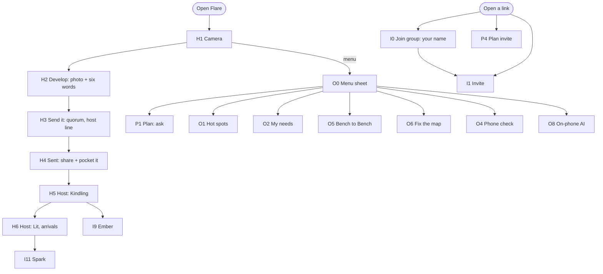
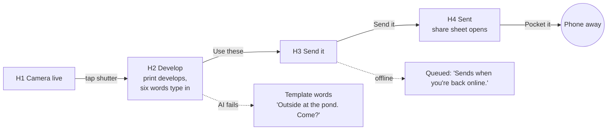
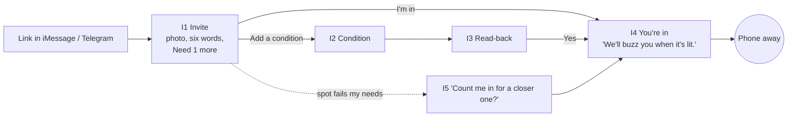
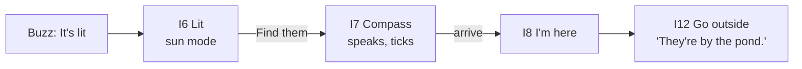
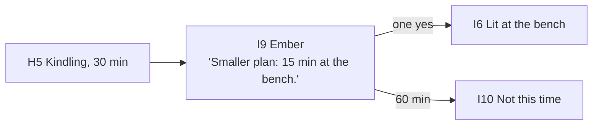
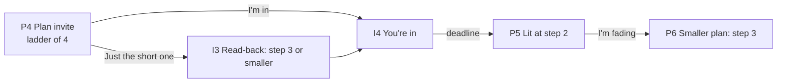
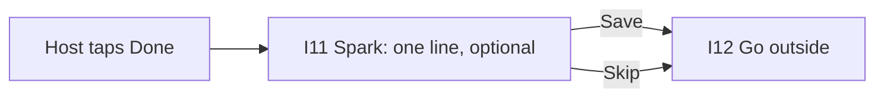

# Flare: User flows and information architecture

Version 1.0, Sat 2026-10-10. Screen ids (H, I, P, O, W) are used in wireframes, hi-fi exports, the prototype and the RTM `design` column.

## 1. Information architecture

There is no home feed and no tab bar. The app opens to the camera; everything else is reached from a gathering's link or a small menu.

Routes (prototype and app):

| Route | Screens |
| --- | --- |
| `/` | H1 to H4 (create) |
| `/g/{group}#key` | I0 join; group menu |
| `/f/{id}#key` | I1 to I12 (Flare, by state); H5, H6 for the host |
| `/p/new` | P1, P2, P3 |
| `/p/{id}#key` | P4 to P7 |
| `/hot` | O1 |
| `/needs` | O2 |
| `/loop` | O5 |
| `/mapfix` | O6 |
| `/check` | O4 |
| `/ai` | O8 |
| `/site` (website, separate deploy) | W1 to W6 |

## 2. Screen inventory

| Id | Screen | Mode | States designed |
| --- | --- | --- | --- |
| H1 | Camera | light/dark | live, permission ask, denied (pick a photo), loading |
| H2 | Develop | light/dark | developing, drafted, AI failed (template), offline |
| H3 | Send it | light/dark | ready, editing, sending, error, offline (queued) |
| H4 | Sent | light/dark | success |
| H5 | Host: Kindling | sun | 0 of N, growing, near lit, offline |
| H6 | Host: Lit | sun | lit, arrivals, +1 sheet, done confirm |
| I0 | Join group | light/dark | empty, typing, error |
| I1 | Invite | light/dark/sun | Kindling, loading, missing key, already lit, gone |
| I2 | Add a condition | light/dark | empty, typing, dictating, didn't catch, name not in group |
| I3 | Read-back | light/dark | confirm |
| I4 | You're in | light/dark | success, queued offline |
| I5 | Spot may not suit you | light/dark | prompt |
| I6 | Lit | sun | lit, offline saved, smaller plan (after fade) |
| I7 | Find them (compass) | sun | pointing, facing, no orientation, no GPS, offline |
| I8 | I'm here | sun | success |
| I9 | Ember | sun | ember waiting, ember lit |
| I10 | Not this time | light/dark | gone |
| I11 | Spark | light/dark | empty, typing, saved, skipped |
| I12 | Go outside (end) | light/dark | end of flow |
| P1 | Plan: ask | light/dark | empty, typing, time pickers, deadline error |
| P2 | Ladder | light/dark | drafting, drafted, editing a step, after-sunset warning |
| P3 | Plan sent | light/dark | success |
| P4 | Plan invite | light/dark | open, need N more, with condition |
| P5 | Plan lit | sun | lit at step n |
| P6 | I'm fading | sun | confirm, smaller plan notice |
| P7 | Plan not this time | light/dark | gone |
| O0 | Menu sheet | light/dark | open |
| O1 | Hot spots | light/dark | empty, list |
| O2 | My needs | light/dark | empty, set |
| O3 | Offline banner | all | component |
| O4 | Phone check | light/dark | running, report |
| O5 | Bench to Bench | light/dark | request, read-back, loop + card preview, no loop fits |
| O6 | Fix the map | light/dark | drafting, review, export ready |
| O8 | On-phone AI | light/dark | not downloaded, downloading, ready, failed |
| W1 to W6 | Website sections | mobile/desktop | see 06-website.md |

## 3. Key flows

### F1 Send a Flare (host), target ≤ 15 s

### F2 Say yes, with a condition (invitee), target ≤ 10 s

### F3 It lights, find your friend

### F4 Shrinks to an Ember

### F5 Answer a Plan, then fade

### F6 Leave a Spark

## 4. Navigation rules

- No back stacks deeper than 2. Close (×) returns to the previous screen; the flow end screen has no "home" button, only "Close".
- Sheets (Bits UI Dialog) for secondary actions: +1, menu, condition, Done confirm.
- Every screen has exactly one primary button. Secondary actions are text buttons.
- The menu (O0) opens from a 44 pt button on the camera screen; it is the only global navigation.
