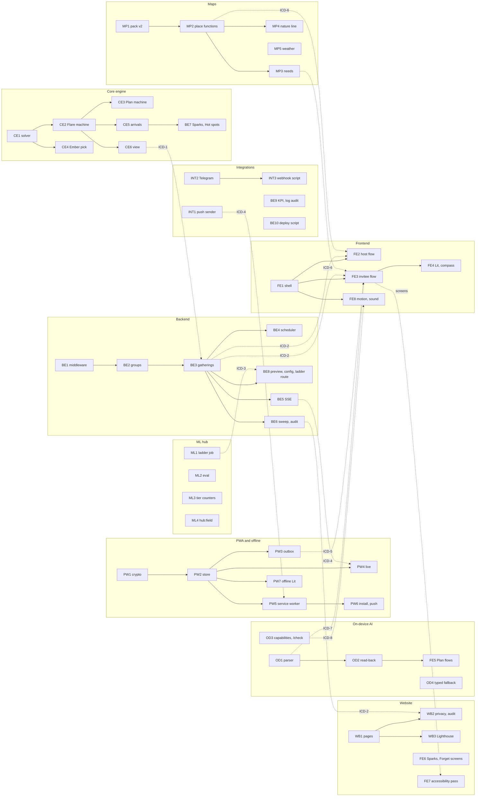

# Flare: Dependencies, branching, review and definition of done

Version 1.0, Sat 2026-10-10. Owner: Engineering lead.

## 1. Dependency graph

Solid arrows are build dependencies inside one specialist's queue (do A before B). Dotted arrows are integration dependencies: the consumer builds against the frozen interface with a fake (02-interface-control.md section 4) and only needs the real module at an integration point. **No solid arrow crosses between specialists**, which is what lets all nine start now and finish without waiting.

### Longest chains (critical path)

| Chain | Hours | Finishes by (start 20:00) |
| --- | --- | --- |
| FE1 → FE3 → FE4, then FE2 and FE8 | 2 + 4 + 3 + 4 + 1 = 14 | 10:00 with no slack; FE starts with FE1 → FE3 → FE4 (the invitee path is the demo) |
| CE1 → CE2 → CE3 → CE4 → CE5 → CE6 → BE7 | 13.5 | 09:30 |
| BE1 → BE2 → BE3 → BE4 → BE5 → BE6 → BE8 | 13.5 | 09:30 |

The frontend is the tightest. If FE is behind at the 05:00 integration, FE2's share sheet polish and FE8 sound move to after RC (P0 flows stay; motion falls back to the CSS flame, which is already a gate outcome).

### Integration points

| Time (ET) | What is joined | Gate |
| --- | --- | --- |
| Sun 01:00 | Engine into backend (fakes out of BE) | API tests pass against the real engine |
| Sun 05:00 | Backend, crypto, store, outbox and parser into the invitee flow | e2e: open link → I'm in → count changes on a second browser |
| Sun 08:00 | Everything; deploy rehearsal with `--dry-run` | e2e suite J1 to J5 in Chrome; axe 0; budget |
| Sun 08:30 | Device checklist (05-device-checklist.md), parallel with fixes | Results recorded |
| Sun 09:30 | RC tag `rc-1`, then deploy on the founder's yes | `npm run ci` green, e2e green, audit pass |

## 2. Branching

- **Trunk-based.** `main` is always releasable: CI green, e2e-hello passing.
- One short-lived branch per work package: `wp/{ID}-{slug}`, for example `wp/CE1-solver`. Branch from the latest `main`, live under 4 hours, rebase (or sync) before the PR.
- Each specialist works in their own git worktree, so nobody shares a working copy.
- Pushes go to the private repo `Hotragn/flare` (pre-approved). Nothing goes public before the founder's yes.
- Interface changes: a branch named `icd/{n}-{slug}` with the `icd-change` label (02-interface-control.md section 3).
- After RC: only branches named `fix/BUG-{n}`, each with a BUGLOG entry.
- After the DEV deadline (Mon 06:59 UTC): every commit is listed in README "Changes after the DEV deadline" (SRS-MNT-2).

## 3. Review

| Rule | Detail |
| --- | --- |
| Who | The engineering lead reviews every PR; an ICD change also needs each consumer owner's acknowledgement |
| How fast | First review within 30 minutes during the build window |
| Size | Under about 400 changed lines; split otherwise |
| Merge | Squash merge after green CI; the commit message keeps the WP id and requirement ids |
| What the reviewer checks | The WP's "Done when" bar; the 7 privacy rules in 11-coding-standards.md section 3; tests named with rule ids; no new log fields; copy from the deck; contract and code changed together |
| Blocking | A failing check, a privacy rule broken, or an untested rule. Style nits never block |
| Pairing | Allowed for review when both are in the same area; the lead still approves |

PR template (`.github/pull_request_template.md`): WP id, requirement ids, what changed, how it was tested (with command output), screenshots for UI, and the definition-of-done checklist below.

## 4. Definition of done

### For every work package

1. **Built to the interface.** It uses and provides only the frozen ICD types and contracts; `tsc`, `npm run contracts` pass.
2. **Tested.** Unit tests for every rule it implements, named with the rule id; error paths tested; fakes in `test/fakes/` only.
3. **CI green.** `npm run ci`: secret scan, lint, types, tests, contracts, build, JS budget, diagrams.
4. **Privacy rules hold.** Nothing readable leaves the phone except as the contract allows; no new log fields; new tables have `expires_at` and cascade.
5. **UI work only:** copy from the deck (copy-lint 0), axe 0 serious or critical on its screens, 44 px targets, Reduce Motion respected, works at 390 px wide with no sideways scroll.
6. **No placeholders.** No TODO, no stub, no fake data in production code.
7. **Recorded.** RTM rows (code path, test name, proof) filled; `docs/engineering/notes/{WP}.md` with what was built, numbers, and anything the next person must know; BUGLOG entry for any bug solved.
8. **Merged to main** through review.

### Per work package

The "Done when" column in [01-work-breakdown.md](01-work-breakdown.md) is each package's own bar on top of the eight points above.

### For the release candidate

- All P0 packages merged; e2e journeys J1 to J5 pass in Chrome at 390 × 844.
- `npm run ci` green on GitHub Actions for the RC commit.
- `npm run e2e:hello` green against the real Ollama.
- Deletion audit `pass: true` after a scripted full flow.
- Device checklist results recorded; any failed check has a decided fallback.
- Deploy plan printed by `npm run deploy:render -- --dry-run`, waiting for the founder's yes.
