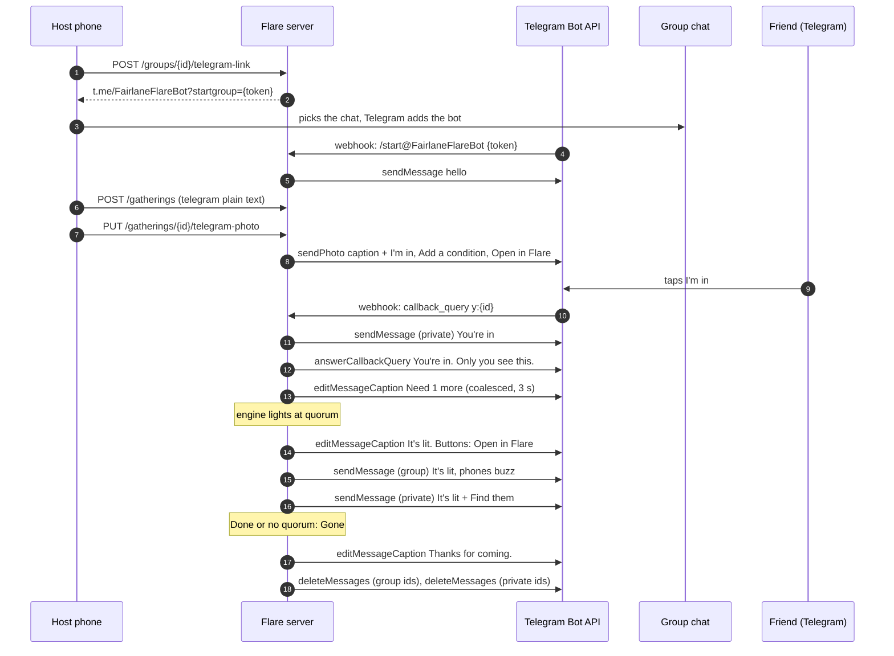

# Message flow: one Flare through Telegram

Proved end to end by `apps/server/test/integrations/flow.test.ts` (fake Bot API, real schema on PGlite, a fake engine that lights at quorum).

## Steps and what is stored

| Step | Server call | Stored | Deleted |
| --- | --- | --- | --- |
| Link | `telegram_links` row (hash, 15 min) | token hash | on use or expiry |
| Post | `sendPhoto` from memory, or `sendMessage` after 15 s | `bot_messages (chat_id, message_id)` | at Gone, after `deleteMessages` |
| Tap I'm in | member `via='telegram'`, `name_ct` null, `telegram_user_id` | member, response | response with the gathering; member with the group |
| Private yes message | `sendMessage` to the user | its id in `bot_messages` | at Gone |
| Add a condition | `telegram_binds` (hash, 10 min) | token hash | on bind, expiry, or with the gathering |
| Bind on the phone | answer moved to the phone's member, Telegram member deleted | `members.telegram_user_id` on the phone member | with the group |
| Lit | edit, group message, private messages | their ids | at Gone |
| Gone | edit, then `deleteMessages` 20 s later | message ids held in memory | rows dropped at once |

The photo for Telegram is never stored: it is sent from the request buffer, and the buffer is zero-filled after.

## Failure handling

| What fails | What happens |
| --- | --- |
| Telegram is slow | The webhook answers 200 at once and works after the response. Updates from one chat run in order |
| Telegram retries an update | `tg:{update_id}` in `idempotency` (24 h); the second copy does nothing |
| 429 Too Many Requests | Wait `retry_after` (at most 10 s), try again, up to 2 times |
| Edit says "message is not modified" | Ignored |
| Server restarted before the post | `bot.resume()` posts every Telegram Flare still in kindling with no message |
| Server restarted after a text post | The first edit tries `editMessageCaption`, gets 400, and switches to `editMessageText` |
| `deleteMessages` fails | Retried after 10 s, 40 s and 70 s (2 min in all), then logged `{event: "tg.delete_failed", count}`. The ids are held in memory, so the sweeper deleting the gathering row first does not stop the delete |
| User never started the bot | Private messages fail with 403; the tap answer says [bot.cb.yesNoChat] instead |

All posts are under 36 hours old at Gone (BR-P-1), inside Telegram's 48-hour delete window.
