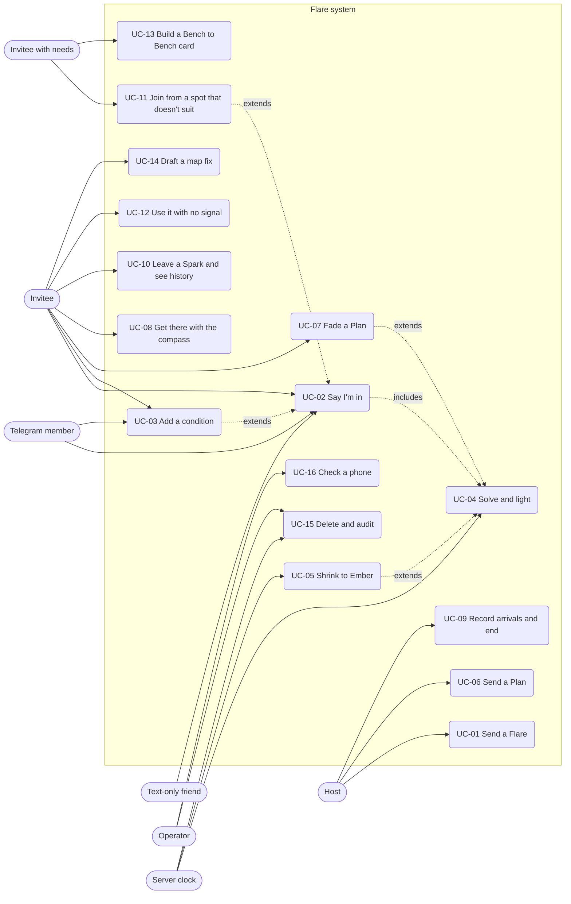

# Flare: Use cases

Version 1.0, Sat 2026-10-10. Owner: Analyst. Each use case lists the main path, alternate paths (A) and failure paths (F). Requirement IDs refer to 01-srs.md; rules to 03-business-rules.md.

## Use-case diagram

## UC-01 Send a Flare
- **Actor:** Host. **Pre:** Host is in a group (has its link) or creating a new one. **Post:** Gathering in Kindling; invite delivered on the host's chosen channels.
- **Main:**
  1. Host opens the app; camera is live (SRS-CRE-1).
  2. Host taps to capture.
  3. App names the spot (SRS-CRE-3) and drafts invite and scene (SRS-CRE-4, SRS-AI-1).
  4. Host accepts or edits; optionally taps the quorum chip (SRS-CRE-5).
  5. Host taps Send. Photo is encrypted (SRS-CRE-6); server creates the Flare; link, text form and bot post are produced (SRS-CRE-7).
- **A1** Camera denied: host picks a photo (SRS-CRE-2).
- **A2** No named feature within 150 m: street name used.
- **A3** AI tiers unavailable: template invite "Outside at {spot}. Come?" (rules tier).
- **A4** New group: app creates group id, key and the host's member id (SRS-ID-1, SRS-ID-3).
- **F1** No signal at Send: Flare is queued in the outbox with "Sends when you're back online." No timer starts until the server accepts it (t0 = server receipt).
- **F2** Group has 12 members already and the host adds one: "Groups max out at 12." (SRS-ID-5).

## UC-02 Say I'm in
- **Actor:** Invitee, Telegram member, or text-only friend. **Pre:** Gathering in Kindling or Ember. **Post:** Yes recorded privately; counts updated.
- **Main:**
  1. Invitee opens the link (SRS-RES-1); photo decrypts with the fragment key.
  2. Invitee taps "I'm in"; sees "You're in." (SRS-RES-3).
  3. Server records the yes and re-runs the solver (includes UC-04).
- **A1** Telegram: member taps "I'm in" on the bot post; bot confirms privately (SRS-CH-2).
- **A2** Text-only: friend replies `IN K7Q2` by SMS; a member enters it (SRS-CH-6, BR-ID-6).
- **A3** Take it back before Lit (SRS-RES-6).
- **A4** Gathering already Lit: page shows the Lit screen; a new yes joins if the solver can add them (BR-P-6 for Plans; for Flares any yes after Lit is added to the set).
- **F1** Missing key: "This link is missing its key." (SRS-RES-2).
- **F2** Gathering Gone: "Not this time." (or "Thanks for coming." if it was Lit).
- **F3** Offline: tap queued in outbox (SRS-OFF-3).

## UC-03 Add a condition
- **Actor:** Invitee. **Pre:** Saying yes (UC-02). **Post:** Structured rules attached to the yes.
- **Main:**
  1. Invitee taps "Add a condition", types or dictates text.
  2. Phone parses (rules or hub tier; phone tier when available) (SRS-COND-1, 3, 4).
  3. Phone reads back in ≤ 12 words (SRS-COND-5). Invitee taps Yes.
  4. Only the rules are sent (SRS-COND-6).
- **A1** "Fix it": back to step 1 with the text kept.
- **A2** Telegram member sends the condition by private message; bot reads back (SRS-CH-3).
- **F1** Unparseable: hint message (SRS-COND-8).
- **F2** `with` names nobody in the group (SRS-COND-7).

## UC-04 Solve and light
- **Actor:** Server clock (and any change event). **Pre:** Gathering in Kindling, Ember, or at Plan deadline. **Post:** "Need N more" updated; possibly Lit.
- **Main (Flare):**
  1. On each event the solver picks the best set (SRS-SOL-1).
  2. If the set reaches quorum, state becomes Lit (BR-F-2).
  3. Every member in the set is notified within 10 s (SRS-LIT-1); phones save offline data (SRS-OFF-1).
- **Main (Plan):** at D the solver picks step and set (SRS-PLAN-5); Lit at that step.
- **A1** Plan: everyone said yes unconditionally before D: lights early at step 1 (BR-P-2).
- **A2** Yes and take-back arrive in the same second: processed in server receipt order (BR-TIME-1).
- **F1** Push unavailable for a member: the open page polls; bot message for Telegram members.

## UC-05 Shrink to Ember
- **Actor:** Server clock. **Pre:** Flare not Lit at t0 + 30:00. **Post:** Ember with quorum 2 at the Ember spot; or Gone at t0 + 60:00.
- **Main:**
  1. At t0 + 30:00 server asks phones to check candidate benches (BR-E-3).
  2. After reports (or 60 s), server picks the Ember spot (BR-E-1, BR-E-4).
  3. All see "Smaller plan: 15 min at {bench}." (SRS-EMB-2).
  4. One more yes (or an "Ember only" yes already present) lights it (BR-E-6).
- **A1** No suitable bench: original spot (BR-E-2).
- **F1** Nobody joins by t0 + 60:00: "Not this time." for all (SRS-ST-3).

## UC-06 Send a Plan
- **Actor:** Host. **Pre:** In a group. **Post:** Plan in Kindling with a 4-step ladder.
- **Main:**
  1. Host types or says the ask ("Fairlane walk at 11?") and picks S and D (SRS-PLAN-1).
  2. App drafts the ladder from weather, sunset and nearby places (SRS-PLAN-2).
  3. Host edits any step; sunset warnings shown (SRS-PLAN-3).
  4. Host picks quorum (default 3) and sends.
- **A1** Hub unavailable: template ladder.
- **F1** D too close to now or to S: "Give friends at least 10 minutes." (BR-P-1).
- **F2** Nothing fits at D: Gone, "Not this time."

## UC-07 Fade a Plan
- **Actor:** Member of the chosen set. **Pre:** Plan Lit, before S + 50% of step minutes, member hasn't faded. **Post:** Plan one step smaller.
- **Main:**
  1. Member taps "I'm fading" (private).
  2. Server lowers the step and re-solves (BR-P-6).
  3. All see "Smaller plan: {step}." (BR-P-7); offline data and compass update (SRS-PLAN-8).
- **A1** Already at step 4: tap accepted, no change, no message. **[Analyst decision]**
- **F1** Second fade by the same member: button no longer shown.

## UC-08 Get there with the compass
- **Actor:** Member in the set. **Pre:** Lit; target saved. **Post:** Member reaches the spot.
- **Main:**
  1. Member taps "Find them"; grants orientation permission if asked.
  2. Arrow, distance and speech guide them (SRS-CMP-1, 2, 3).
- **A1** Host shares live location (P1): target follows the host (SRS-CMP-6).
- **A2** Screen locked: speech continues where iOS allows.
- **F1** Orientation unavailable or noisy: distance-only speech, "Hold your phone flat."
- **F2** GPS unavailable: "Can't find you yet." and the host line stays visible.

## UC-09 Record arrivals and end
- **Actor:** Host, arriving member. **Pre:** Lit. **Post:** Headcount final; gathering Gone.
- **Main:**
  1. Arriving member taps "I'm here" or host taps +1 (SRS-LIT-3).
  2. Host taps Done (SRS-LIT-4); state Gone; deletion begins (SRS-PRIV-2).
- **A1** Nobody taps Done: Gone at the timeout (BR-F-5, BR-P-8).
- **F1** Arrival tapped offline: outbox, accepted per BR-H-5.
- **F2** Taps over the cap: ignored (BR-H-4).

## UC-10 Leave a Spark and see history
- **Actor:** Member with an accepted arrival. **Pre:** Gathering Done. **Post:** Encrypted Spark stored; Hot spots updated.
- **Main:**
  1. App shows the Spark prompt once (BR-K-3).
  2. Member writes ≤ 140 characters and saves; it is encrypted (BR-K-4).
  3. Next gathering at that place shows "Your group met here N times." and the Spark (SRS-SPK-2).
- **A1** Member dismisses: no Spark, no reminder.
- **A2** Member opens Hot spots (SRS-HOT-1).

## UC-11 Join from a spot that doesn't suit
- **Actor:** Invitee with needs. **Pre:** Needs profile set (SRS-ACC-1). **Post:** "Ember only" yes recorded with no reason.
- **Main:**
  1. Phone checks the spot (BR-A-2) and it fails.
  2. Phone asks "This spot may not suit you. Count me in for a closer one?"
  3. Member taps Yes; an "Ember only" yes is sent (SRS-ACC-3).
  4. At Ember, the bench is chosen to suit them (BR-E-1) and their yes counts.
- **A1** Plan: failed steps act as `max_step` for them (SRS-PLAN-6).
- **F1** No suitable bench within 400 m: the original spot is used; their yes still counts toward Ember. **[Analyst decision: the person chose to be counted; the app shows them the access line so they can decide.]**

## UC-12 Use it with no signal
- **Actor:** Member. **Pre:** Gathering Lit while online. **Post:** Offline taps synced later.
- **Main:**
  1. At Lit, data is saved (SRS-OFF-1).
  2. Offline, the Lit screen and compass work (SRS-OFF-2).
  3. Taps queue and send once on reconnect (SRS-OFF-3).
- **A1** A fade happens while a member is offline: their screen shows the last saved step and "Offline. Saved at {time}." until they reconnect.
- **F1** Phone never online after Lit: the member still has the saved plan; their arrival isn't counted until they reconnect within the Lit window.

## UC-13 Build a Bench to Bench card (P1)
- **Actor:** Member with needs. **Pre:** A spot chosen. **Post:** PDF card and audio turns.
- **Main:** request in words (SRS-REST-1) → read-back → loop (SRS-REST-2, 3) → card (SRS-REST-5) → print or save; audio available (SRS-REST-6).
- **F1** No loop fits (SRS-REST-4).

## UC-14 Draft a map fix (P1)
- **Actor:** Member. **Post:** Exported Note text or `.osm` file; nothing published.
- **Main:** photo → draft tags (SRS-MAP-1) → review every tag (SRS-MAP-2) → export (SRS-MAP-3); photo deleted (SRS-MAP-4).
- **F1** AI unavailable: manual tag form with the allow-list.

## UC-15 Delete and audit
- **Actor:** Server clock, operator. **Pre:** Gathering Gone. **Post:** 0 per-gathering records remain.
- **Main:** delete job runs within 5 min (SRS-PRIV-2); bot deletes its posts (SRS-CH-4); storage expiry backs it up; operator runs the audit (SRS-PRIV-5) and saves the output.
- **F1** Delete job fails: storage expiry removes records by t0 + 5 h (Flare) or S + 24 h (Plan); the audit flags them until then.
- **F2** Telegram lets bots delete only messages younger than 48 h. Flares end within 4 h and Plans start within 36 h (BR-P-1), so every post is deletable; a failed delete is logged and retried 3 times.

## UC-16 Check a phone
- **Actor:** Operator or tester. **Main:** open `/check`, run tests, copy report (SRS-CAP-1). **Post:** Tier per phone known before the field test.
