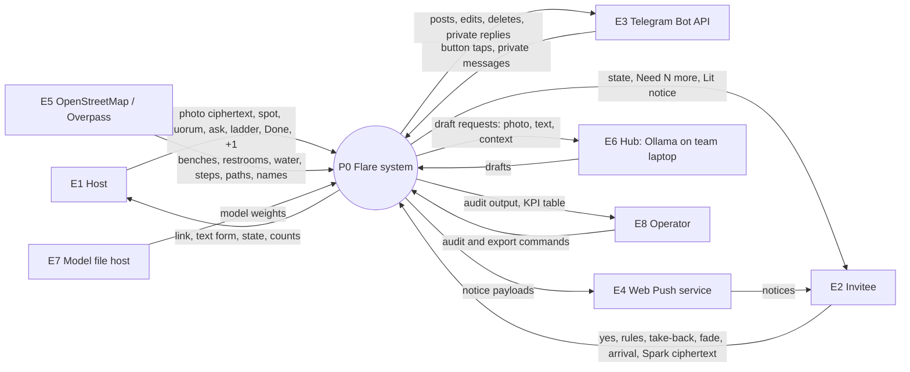
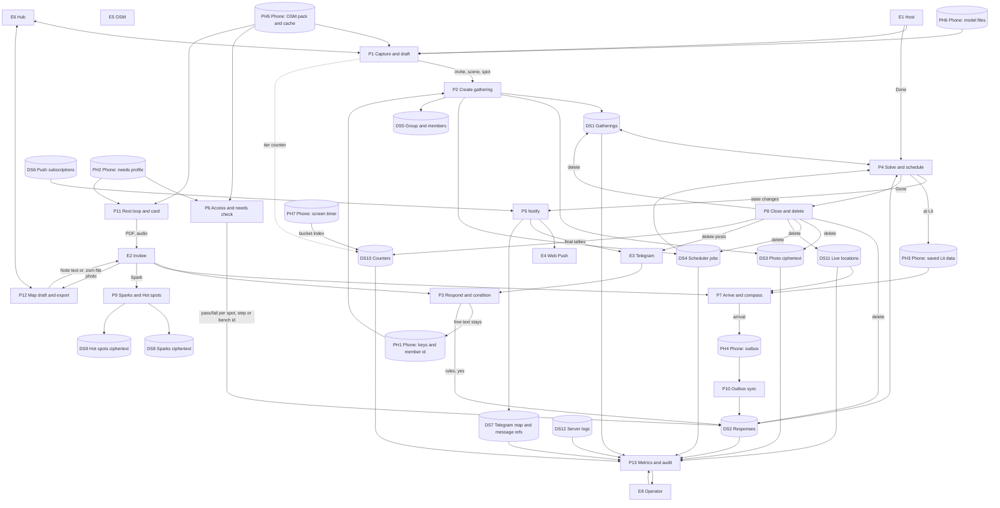

# Flare: Logical data flow and data dictionary

Version 1.0, Sat 2026-10-10. Owner: Analyst. This is logical: it names data and flows, not tables or technologies. The architect maps each store to a physical one and keeps the store list in sync with the deletion audit (BR-D-7).

Legend: **E** external entity, **P** process, **DS** data store. Stores marked *(phone)* never leave the device.

## Level 0 (context)

Note: OSM, model files and hub calls flow into the phone part of P0 for phone-side processes; photos sent to the hub go only over the authenticated route (SRS-IF-5) and are not stored there.

## Level 1

## Process descriptions

| P | Name | In | Out | Rules | SRS |
| --- | --- | --- | --- | --- | --- |
| P1 | Capture and draft | Photo, location, OSM pack, model or hub | Invite, scene, spot name, tier | BR-AI-1 to 3 | SRS-CRE-1 to 4, SRS-AI-1 to 5 |
| P2 | Create gathering | Draft, quorum, ask, ladder, S, D, group key | Gathering, photo ciphertext, timers | BR-Q-2, BR-P-1, BR-P-4 | SRS-CRE-5 to 8, SRS-PLAN-1 to 4 |
| P3 | Respond and condition | Yes, free text (phone only), rules | Response records | BR-C-1 to 10, BR-ID-6 | SRS-RES-*, SRS-COND-* |
| P4 | Solve and schedule | Responses, timers, Done, fades | State, set, step, N | BR-S-*, BR-F-*, BR-P-*, BR-E-* | SRS-SOL-*, SRS-ST-*, SRS-EMB-*, SRS-PLAN-5 to 9 |
| P5 | Notify | State changes, subscriptions, chat refs | Push, bot posts and edits | BR-CH-1 | SRS-LIT-1, SRS-CH-1 to 4 |
| P6 | Access and needs check | Needs profile, OSM, candidate ids | Pass/fail per id, "Ember only" flag | BR-A-1 to 4, BR-E-3 | SRS-ACC-*, SRS-PLAN-6 |
| P7 | Arrive and compass | Saved Lit data, GPS, orientation, live location | Arrival taps, speech | BR-H-* | SRS-LIT-3, SRS-CMP-* |
| P8 | Close and delete | Gone event | Deletes, final tallies | BR-D-1 to 3 | SRS-PRIV-2, SRS-CH-4 |
| P9 | Sparks and Hot spots | Spark text (encrypted on phone), place key | Spark and blob ciphertext | BR-K-* | SRS-SPK-*, SRS-HOT-* |
| P10 | Outbox sync | Queued taps | Accepted or dropped taps | BR-H-5 | SRS-OFF-3 |
| P11 | Rest loop and card | Request, needs, OSM paths | PDF card, audio turns | FR-REST-* | SRS-REST-* |
| P12 | Map draft and export | Photo, location, allow-list | Note text or `.osm` | BR-AI-4 | SRS-MAP-* |
| P13 | Metrics and audit | Counters, every store | KPI table, audit output | BR-D-7 | SRS-PRIV-5, SRS-FLD-1 |

## Data dictionary

Types: `id128` = 128 random bits, base32 text; `ts` = UTC timestamp to the millisecond; `ct` = ciphertext (AES-256-GCM, nonce prepended) under the group key; `enum(...)`.

### DS1 Gatherings (deleted at Gone, expiry backup)

| Field | Type | Notes |
| --- | --- | --- |
| gathering_id | id128 | Primary key |
| group_id | id128 | |
| kind | enum(flare, plan) | |
| state | enum(kindling, lit, ember, gone) | |
| short_code | 5 chars | BR-CH-3 |
| host_member_id | id128 | |
| quorum | int | 2 to 4 (Flare), 2 to 6 (Plan) |
| created_at | ts | t0 for a Flare |
| deadline_at, start_at | ts | Plans only |
| tz | IANA tz name | BR-TIME-2 |
| spot | {place_key, name_ct, lat, lon} | lat/lon needed for Ember search and compass; deleted at Gone |
| invite_ct, scene_ct, host_line_ct | ct | Text encrypted on the phone |
| ladder | list of 4 {step, name_ct, place_key, lat, lon, minutes} | Plans only |
| current_step | int 1 to 4 | Plans |
| ember_spot | {bench_osm_id, lat, lon} | Set at Ember |
| chosen_set | list of member_id | Solver output; never sent to clients |
| lit_at, done_at | ts | |
| headcount | int | |
| expires_at | ts | Storage expiry (BR-D-2) |

### DS2 Responses (deleted at Gone)

| Field | Type | Notes |
| --- | --- | --- |
| gathering_id | id128 | |
| member_id | id128 or null | null for anonymous text yes (BR-ID-6) |
| status | enum(yes, taken_back, cant_make_it) | |
| ember_only | bool | BR-A-3 |
| rules | list of {type, value} | BR-C-1; no free text |
| spot_checks | map of candidate id → pass/fail | From P6 |
| faded | bool | Plans |
| arrived | bool, arrived_at ts | |
| idem_keys | set | For dedupe |
| write_token_hash | hash | SRS-SEC-4 |

### DS3 Photo ciphertext (deleted at Gone)
`gathering_id`, `photo_ct` (≤ 1.5 MB after on-phone resize to 1600 px long edge, JPEG quality 80), `blur_preview` (server-stored only as a 32 px blurred JPEG made on the phone, for link previews; deleted at Gone).

### DS4 Scheduler jobs (deleted at Gone)
`job_id`, `gathering_id`, `kind enum(ember, gone, plan_deadline, delete)`, `due_at ts`.

### DS5 Group and members (kept while the group is active)
`group_id`, `created_at`, `last_gathering_at`; members: `member_id`, `name_ct`, `joined_at`, `write_token_hash`. Deleted per BR-D-5 or "Forget this group".

### DS6 Push subscriptions
`member_id`, `endpoint`, `keys`, `created_at`. Deleted 30 days after the group's last gathering (BR-D-5).

### DS7 Telegram map and message refs
Map: `telegram_user_id → member_id` per group (BR-ID-5). Message refs: `gathering_id`, `chat_id`, `message_id` (deleted after bot deletes at Gone).

### DS8 Sparks ciphertext (opt-in, 180 days)
`spark_id`, `group_id`, `place_key_hash` (HMAC of place key with a key derived from the group key, so the server can't read places), `text_ct`, `created_at`.

### DS9 Hot spots ciphertext (180 days)
`group_id`, `blob_ct`, `version`. Plain content (on phone only): list of {place_key, place_name, count, last_date, newest_spark_id}.

### DS10 Counters (kept)
Exactly the counters in docs/product/07-kpis.md, keyed by `group_id`, plus `tier_ran[job][tier]` global totals. No timestamps finer than the day.

### DS11 Live locations (P1; deleted at Gone)
`gathering_id`, `member_id` (host), `lat`, `lon`, `at`. Overwritten in place; no history.

### DS12 Server logs (7 days)
Method, route template (no ids in path segments beyond a hashed form), status, latency, time. Never bodies, fragments, names, locations or tokens (BR-D-6).

### Phone stores (never sent)

| Store | Contents | Lifetime |
| --- | --- | --- |
| PH1 | Group keys, member ids, write tokens, display names (plain), free-text conditions | Until "Forget this group" |
| PH2 | Needs profile (BR-A-1) | Until the person clears it |
| PH3 | Saved Lit data (SRS-OFF-1) | Deleted when the phone learns Gone, or 24 h after Lit |
| PH4 | Outbox items {idem_key, kind, payload, recorded_at} | Until accepted or 24 h |
| PH5 | Fairlane pack, Overpass cache | 7 days (cache); pack ships with the app |
| PH6 | Model files | Until the person removes them |
| PH7 | Screen timer (foreground start/stop per gathering) | Deleted after the bucket is sent |
| PH8 | Map drafts (photo deleted after drafting; tags kept until export) | Until exported or discarded |
| PH9 | Rest-loop cards (PDF) | Saved where the person puts them |
| PH10 | Capability report | Until closed |

## Deletion audit coverage

The audit (BR-D-7) must count per-gathering records in DS1, DS2, DS3, DS4, DS7 (message refs), DS11, and search DS12 for any gathering id or short code. Passing = 0 for gatherings that are Gone. It also reports totals for DS5 to DS10 so retention (BR-D-5) can be checked.
